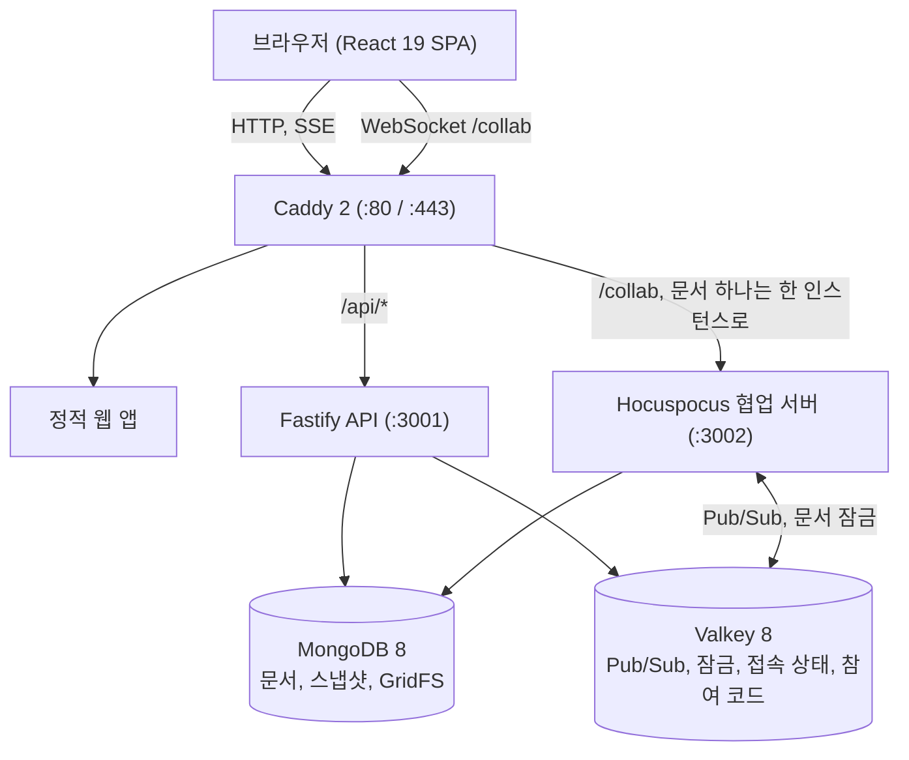

[English](README.md) | [한국어](README.ko.md)

# gachipad

> 같은 네트워크에서 실시간으로 코드를 공유하고 함께 편집하는 셀프 호스팅 서비스

gachipad는 같은 네트워크에서 브라우저만으로 코드를 공유하고 실시간으로 함께 편집할 수 있는 셀프 호스팅 서비스예요. 회원가입이나 외부 클라우드, 분석 스크립트, CDN이 전혀 필요 없어요. 모든 글꼴과 아이콘, 스크립트를 자체 서버에서 직접 제공하기 때문에 인터넷이 연결되지 않은 오프라인 환경이나 내부 네트워크에서도 그대로 동작해요. Yjs CRDT를 통해 충돌 없이 안전하게 편집을 병합하고, 200개 이상의 프로그래밍 언어 문법 강조를 지원해요. 실습실 모드에서는 강사가 수강생 전원의 에디터를 실시간 격자 화면으로 한눈에 살펴볼 수 있어요.


## 스크린샷

| | |
|---|---|
|  |  |
|  |  |
|  |  |
|  |  |

## 주요 기능

### 공유와 참여
- **바로 만드는 공유**: 클릭 한 번으로 8자리 주소(`/<id>`)와 6자리 숫자 참여 코드(`/<code>`)가 생겨요. 기본 설정에서는 가입 없이 바로 쓸 수 있어요.
- **원하는 방식으로 참여**: 6자리 참여 코드를 입력하거나, 링크를 열거나, 브라우저가 직접 그리는 QR 코드를 스캔해 참여할 수 있어요(프로젝터용 전체 화면 지원).
- **근처 공유 탐색**: 같은 서브넷이나 관리자가 지정한 방에 열려 있는 공유가 시작 화면에 자동으로 나타나요.
- **공유 전송 및 방 전체 안내**: 접속 중인 사용자에게 최대 200자 메모와 함께 공유를 직접 보내거나, 방 전체에 참여 안내를 띄울 수 있어요.

### 함께 편집
- **충돌 없는 실시간 편집**: Yjs와 Hocuspocus가 여러 사용자의 동시 입력을 자동으로 합쳐줘요. 연결이 끊긴 동안 작성한 편집도 다시 연결되면 깔끔하게 병합돼요.
- **커서와 화면 따라가기**: 모든 참여자의 커서와 선택 영역에 고유 색상과 이름이 표시돼요. 참여자 이름을 클릭하면 그 사람의 편집 화면을 실시간으로 따라갈 수 있어요. 원격 편집으로 인해 로컬 커서 깜빡임 리듬이 깨지지 않으며 참여자 이름표도 안정적으로 유지돼요.
- **부드러운 입력**: 타이핑 시 커서가 100ms 감속 곡선으로 미끄러지듯 이동하고 1.2초 주기의 페이드 깜빡임이 적용돼요. 동작 줄이기 설정에서는 고정 커서로 동작해요.
- **코드 자동 완성 및 언어 제안**: 입력을 잠시 멈추면 키워드와 문서 안의 단어로 자동 완성 목록이 뜨고, Tab으로 넣을 수 있어요. 일반 텍스트 입력 중 언어가 감지되면 상태 표시줄에 언어 제안이 나타나 클릭 한 번으로 적용할 수 있어요.
- **여러 파일과 폴더 구성**: 공유 하나당 최대 100개 파일까지 경로(`src/index.ts`)를 이용해 폴더로 정리할 수 있고, 파일 이름에서 언어를 자동으로 감지해요.
- **200개 이상의 언어와 테마**: 200개 이상의 언어 문법 강조를 지원하며, 네 가지 에디터 테마(Slate, Graphite, Paper, Sand)의 모든 토큰 색상은 WCAG 2.2 AA 명도 대비를 만족해요. 기본 키맵 외에 Vim, Emacs, Sublime 키맵을 선택할 수 있어요.
- **줄에 붙는 코멘트**: 특정 줄이나 범위에 코멘트를 남겨 토론할 수 있으며, 코드가 수정되어 줄 위치가 바뀌어도 제자리를 그대로 유지해요.
- **파일 업로드와 다운로드**: 파일, 폴더, `.zip` 파일을 에디터 창에 바로 끌어다 놓을 수 있고, 개별 파일 또는 공유 전체를 `.zip`으로 내려받을 수 있어요.
- **정리와 빠른 시작**: '내 공유'에서 폴더와 태그(공유당 최대 10개)로 코드를 정리할 수 있고, 기본 템플릿 16개와 관리자가 추가한 템플릿으로 빠르게 시작할 수 있어요.

### 이력
- **자동 스냅샷**: 편집 중 약 30초마다 자동으로 스냅샷을 남기며, 공유당 최대 100개까지 기본 7일간 보관해요.
- **재생과 비교**: 1배속, 2배속, 4배속으로 편집 이력을 재생해 볼 수 있고, 어느 시점이든 직전 버전이나 현재 상태와 나란히 비교할 수 있어요.
- **안전한 복원**: 이전 버전 복원도 일반 편집으로 기록되므로 기존의 전체 이력이 안전하게 유지돼요.
- **지운 내용 보호**: 참여자는 문서의 현재 상태만 받아요. 삭제된 내용은 서버에만 남고 공유 소유자만 이력 화면에서 확인할 수 있어요.

### 실습실
- **실습실 세션**: `/lab/new`에서 6자리 참여 코드로 실습실을 만들면 수강생마다 개인 복사본이 자동으로 준비돼요.
- **실시간 격자 화면**: 강사는 모든 수강생의 접속 상태와 코드를 한눈에 살펴보고, 특정 카드를 확대하거나 해당 에디터에 직접 들어가 지도할 수 있어요.
- **예제 배포**: 강사의 공유 하나를 클릭 한 번으로 모든 수강생의 작업 공간에 동시에 전달할 수 있어요.
- **편집 잠금**: 강사가 설명하는 동안 모든 수강생의 에디터를 읽기 전용으로 잠글 수 있어요.

### 권한과 개인정보
- **보기 전용 링크**: 보기 전용 링크를 기본으로 공유하고, 편집 링크는 신뢰할 수 있는 사용자에게만 따로 줄 수 있어요. 편집 링크는 `#key=…`로 끝나며 브라우저는 이 프래그먼트 부분을 서버로 전송하지 않아요. gachipad는 이 키를 주소창에서 즉시 지워줘요(기존 `?key=` 링크도 정상 작동하며 같은 방식으로 정리돼요).
- **참여자 권한 설정**: 소유자는 공유 창(접근 설정)에서 참여자의 공유 이름 변경, 파일 추가·수정·삭제, 언어 변경 권한을 개별적으로 허용할 수 있어요(서버에서 강제 적용). 권한 변경으로 편집이 거부된 경우 작성 중이던 텍스트는 탭 메모리에 안전하게 보관돼요.
- **PIN 잠금**: 4~32자리 PIN을 scrypt 해시로 안전하게 저장하며, 5번 틀리면 10분간 해당 주소의 입장이 차단돼요.
- **대기실**: 새로 들어오려는 사용자를 소유자가 직접 확인하고 승인해야 입장할 수 있어요.
- **내보내기와 차단**: 특정 사용자를 즉시 퇴장시키거나 클라이언트 ID 및 네트워크 주소 기준으로 차단할 수 있어요.
- **직접 관리하는 오프라인 사본**: 에디터에서 한 번 묻는 질문("이 기기에 저장" / "이 기기에는 저장 안 함", 설정에서 변경 가능)에 답하기 전까지 브라우저는 오프라인 사본을 보관하지 않아요. **이 기기에서 지우기**는 브라우저의 모든 탭에서 해당 공유를 닫고 사본과 저장된 편집 키를 삭제하며, 다시 물어보기 전까지 해당 공유의 사본을 보관하지 않아요. 서버가 확인하지 않은 편집 내용이 있으면 먼저 물어봐요. 내보내기, 차단, 승인 거부, 공유 삭제, 로그아웃이나 계정 전환 시 사본이 자동으로 삭제돼요. 실습실 미리보기는 사본을 보관하지 않아요.
- **로컬 진단 내보내기**: 설정의 진단 탭에서 오류 및 성능 기록(최대 500건, 256KB, 14일)을 확인하고 JSON 파일로 내보낼 수 있어요. 외부로 자동 전송되는 데이터는 전혀 없으며 문서 내용과 비밀값은 제외돼요.
- **런타임에 외부로 나가는 데이터 없음**: 외부 글꼴, CDN, 분석 도구, 외부 위젯이 전혀 없어요. 아래 설명된 릴리스 업데이트 확인만 유일한 선택 사항이며 언제든 끌 수 있어요.

### 안내 및 둘러보기
- **첫 방문 안내**: 에디터를 처음 열 때 주요 기능을 안내해 주는 튜토리얼이 실행되며, 설정에서 언제든 다시 볼 수 있어요.
- **가이드 페이지**: 워크플로, 기능, 네트워크, 보안, FAQ를 상세히 정리한 웹 가이드(`/guide`)를 제공해요.

### 터미널 CLI
CLI는 `packages/cli`에 있으며 이 저장소에서 직접 빌드해요(`pnpm --filter @gachipad/cli build`). `codesh` 명령어는 호환성을 위한 비권장 별칭으로 유지돼요.
- `gachipad push <파일…>`: 파일, 폴더, 표준 입력을 공유하고 URL, 참여 코드, QR 코드를 출력해요.
- `gachipad open <코드|id>`: 브라우저에서 해당 공유를 바로 열어요.
- `gachipad pull <코드|id>`: 공유를 파일이나 `.zip`으로 내려받아요(잠긴 공유는 `--pin` 사용).

### 관리자 콘솔
- **관리자 콘솔**(`/admin`, 관리자 토큰): 공유 유지 시간, 이력 보관 주기, 업로드 크기 제한, 게스트 접근 허용 여부, 근처 공유용 방 설정, 공용 템플릿 관리 등 전체 환경을 설정해요. `ADMIN_ALLOW_CIDR`로 접속 대역을 제한하고, 무차별 대입 방지 전역 토큰 버킷과 일반 HTTP 경고 배너로 보안을 강화했어요.
- **선택적 로그인**: 게스트 입장을 허용한 상태로 OIDC 또는 LDAP 로그인을 연동할 수 있어요.
- **운영 탭**: 개요(실시간 지표, 상태 배지, 24시간 활동 그래프), 공유 관리(검색, 잠금/잠금 해제, 영구 삭제), 진단(로그 필터 및 서버 번들 내보내기), 보안(요청 한도 및 실패 감사 로그), 접속자, 업데이트 탭을 제공해요.

## 사용 방법

1. **시작하기**: 첫 화면에서 **새 공유**를 누르거나 **템플릿으로 시작**을 선택해요.
2. **초대하기**: **공유** 버튼(Mac `⌃⌘S`, Windows·Linux `Ctrl+Alt+S`)을 눌러 링크를 복사하거나, 6자리 참여 코드 또는 QR 코드를 보여줘요.
3. **참여하기**: 첫 화면에 코드를 입력하거나 `/<코드>` 또는 `/<id>` 주소를 열어요.
4. **함께 편집하기**: 실시간 커서, 문법 강조, 인라인 코멘트(`⌃⌘M` / `Ctrl+Alt+M`)를 사용해 코드를 작성해요.
5. **파일 관리하기**: 파일 탐색기 패널에서 파일과 폴더를 추가하거나, 파일 및 `.zip` 파일을 에디터 창에 끌어다 놓아요.
6. **이력 확인하기**: 공유 소유자는 **이력** 메뉴(`⌃⌘H` / `Ctrl+Alt+H`)에서 스냅샷과 차이점을 확인하고 복원할 수 있어요.
7. **내보내기**: 파일 하나를 내려받거나 전체 코드를 `.zip` 압축 파일로 저장해요.

입력창 바깥에서 `?`를 누르면 현재 운영체제에 맞는 단축키 목록이 나와요. 전체 단축키 안내는 [사용자 안내서](docs/USER-GUIDE.md)에 있어요.

| 동작 | Mac | Windows / Linux |
|---|---|---|
| 명령 팔레트 | `⌘ K` 또는 `F1` | `Ctrl + K` 또는 `F1` |
| 공유 창 | `⌃ ⌘ S` | `Ctrl + Alt + S` |
| 설정 | `⌘ ,` | `Ctrl + ,` |
| 코멘트 | `⌃ ⌘ M` | `Ctrl + Alt + M` |
| 이력 (소유자) | `⌃ ⌘ H` | `Ctrl + Alt + H` |
| 전체 코드 복사 | `⌃ ⌘ C` | `Ctrl + Alt + C` |
| 코드 정리 | `⇧ ⌥ F` | `Shift + Alt + F` |
| 찾기 / 찾아 바꾸기 | `⌘ F` / `⌘ ⌥ F` | `Ctrl + F` / `Ctrl + H` |
| 윗줄 / 아랫줄에 커서 추가 | `⌘ ⌥ ↑` / `⌘ ⌥ ↓` | `Ctrl + Alt + ↑` / `Ctrl + Alt + ↓` |
| 같은 단어 다음 항목 선택 | `⌘ D` | `Ctrl + D` |

## 설치

codesh 1.0.x에서 업그레이드하시나요? [운영자 안내서의 이름 변경 안내](docs/OPERATIONS.md#16-codesh에서-gachipad로-이름-변경-10x에서-업그레이드)를 참고하세요.

Docker Engine과 Docker Compose 플러그인(`docker compose`)이 설치된 Linux 서버면 바로 실행할 수 있습니다. 외부에 노출되는 포트는 Caddy의 HTTP(80)와 HTTPS(443)뿐입니다.

| 규모 | 최소 | 권장 | 메모 |
|---|---|---|---|
| 한 공유 50명 | 2 vCPU, 4 GB RAM, SSD 20 GB | 4 vCPU, 8 GB RAM | RAM 4 GB에서는 `MONGO_CACHE_GB=1` |
| 동시 약 200명 (수업, 실습, 소그룹) | 4 vCPU, 8 GB RAM, SSD 40 GB | 8 vCPU, 16 GB RAM | collab 하나로 충분하며 약 400명부터 `COLLAB_REPLICAS=2` |

### 인터넷이 되는 서버: Docker Compose

```sh
git clone https://github.com/kim0040/gachipad.git && cd gachipad/deploy
cp .env.example .env && ./generate-secrets.sh     # 한 번만. .env는 서버에만 둡니다
docker compose pull && docker compose up -d       # ghcr.io/kim0040의 공개 이미지
curl http://localhost/healthz
```

### 인터넷이 없는 서버: 오프라인 번들

인터넷이 되는 PC에서 [GitHub 릴리스](https://github.com/kim0040/gachipad/releases)의 `gachipad-<버전>-linux-amd64.tar.gz`(또는 `-linux-arm64`)와 `.sha256` 파일을 받아 서버로 옮긴 뒤 실행합니다.

```sh
sha256sum -c gachipad-<버전>-linux-amd64.tar.gz.sha256
tar xzf gachipad-<버전>-linux-amd64.tar.gz && cd gachipad-<버전>-linux-amd64
PUBLIC_URL=http://gachipad.local ./install.sh       # 이미지 로드, 새 비밀키로 .env 작성, Linux에서 gachipad.local 제안, 시작
```

네이티브 Linux 환경에서 `install.sh`는 `gachipad.local` mDNS 단축 도메인을 기본 제공하며 이름 충돌을 자동 검사합니다. 이를 건너뛰려면 `--no-mdns`(또는 `GACHIPAD_MDNS=0`)를 지정하고, 옵션 없이 재실행하면 기존 선택이 유지됩니다. 세부 제어 명령과 주의사항은 [운영자 안내서(mDNS)](docs/OPERATIONS.md#5-mdns-gachipadlocal-옵션)를 참고하십시오.

`install.sh`는 이미지를 올리기 전에 번들 안의 `SHA256SUMS`로 모든 파일을 검사합니다. 체크섬은 서명이 아닙니다. `.sha256` 값은 번들과 다른, 신뢰할 수 있는 경로로 받은 값과 대조하십시오. 릴리스 파일에는 빌드 출처 증명도 포함되어 있습니다(`gh attestation verify`, [RELEASING.md](RELEASING.md)). 번들에는 gachipad 이미지와 함께 변경하지 않은 공식 MongoDB, PostgreSQL, Valkey, Caddy, Node 이미지와 `backup.sh`, `restore.sh`, `upgrade.sh`, `update.sh`, `migrate-db.sh`가 들어 있습니다.

오프라인 설치를 업그레이드할 때는 새 번들과 `.sha256` 파일을 같은 폴더에 두고 `./upgrade.sh ../gachipad-<새 버전>-linux-amd64.tar.gz`를 실행합니다. 체크섬 검사, 데이터베이스 백업, 이미지 로드를 진행하며 기존 `.env`는 안전하게 유지됩니다.

### HTTPS

`SITE_ADDRESS=:80`이면 일반 HTTP로 동작합니다. `gachipad.local` 같은 호스트 이름을 쓰려면 `deploy/tls/*.caddy`에 `tls` 설정이 필요합니다. Caddy 내장 CA를 쓰려면 `tls internal`, 직접 준비한 인증서가 있다면 인증서와 키 경로를 적어줍니다. 설정이 없으면 Caddy가 공개 ACME CA 발급을 시도하므로 인터넷이 없는 환경에서는 실패합니다. 일반 HTTP는 같은 네트워크를 볼 수 있는 사람에게 문서 내용과 인증 정보를 그대로 노출하므로, 공용 네트워크에서는 HTTPS를 권장합니다. 자세한 설정과 클라이언트 루트 CA 등록 절차는 [deploy/tls/README.md](deploy/tls/README.md)에 있습니다.

### 데이터베이스

gachipad는 배포 환경에 맞춰 다양한 데이터베이스 백엔드를 지원합니다.

- **SQLite** (신규 설치 기본값): 공유 Docker 볼륨에 WAL 모드로 저장됩니다. 별도의 서버 자격 증명이나 프로세스가 필요 없으며 메모리 사용량이 가장 적습니다.
- **번들 PostgreSQL**: Docker Compose로 PostgreSQL 17을 함께 구동합니다. 다중 collab 인스턴스 확장을 지원합니다.
- **번들 MongoDB**: Docker Compose로 MongoDB 8을 함께 구동합니다. 기존 1.0.x 설치 환경을 데이터 마이그레이션 없이 그대로 승계합니다.
- **외부 데이터베이스**: `DATABASE_URL`을 통해 외부 PostgreSQL, MySQL, MariaDB, MongoDB에 연결합니다 (MySQL과 MariaDB는 외부 서버만 지원합니다).

Valkey는 모든 데이터베이스 옵션에서 실시간 협업 상태 관리를 위해 항상 필수로 실행됩니다. 백엔드별 운영 트레이드오프, 백업·복원 절차 및 오프라인 마이그레이션 방법은 [운영자 안내서](docs/OPERATIONS.md#9-데이터베이스-관리-및-업그레이드)를 참고하십시오.

백업, 수평 확장, 모니터링, `.env` 설정 전체는 [운영자 안내서](docs/OPERATIONS.md)와 [deploy/README.md](deploy/README.md)(영어)에서 확인할 수 있습니다.

## 업데이트

- **릴리스 확인**: `UPDATE_CHECK=on`(기본값)이면 API가 시작되고 몇 분 뒤, 그 뒤로 약 12시간마다 `GET https://api.github.com/repos/<UPDATE_REPO>/releases/latest` 요청을 한 번 보냅니다. gachipad가 외부로 보내는 유일한 요청이며 쿠키, 식별자, 사용 통계를 일절 보내지 않습니다. 다른 요청을 차단하지 않으며 인터넷이 없으면 5초 안에 조용히 시간 초과 처리됩니다. `.env`의 `UPDATE_CHECK=off`로 완전히 끌 수 있습니다. 새 릴리스는 관리자 콘솔에 표시됩니다.
- **되돌리기를 지원하는 수동 업데이트** (설치된 번들 폴더에서):
  ```sh
  ./update.sh --check              # 설치된 버전과 최신 릴리스 비교, 아무것도 바꾸지 않음
  ./update.sh                      # 체크섬 검사, DB 백업, 이미지 풀, /healthz 및 /readyz 확인, 실패 시 되돌림
  ./update.sh --bundle <경로>      # 오프라인 번들 적용
  ```
- **자동 업데이트** (기본 꺼짐):
  ```sh
  sudo ./update.sh --enable-auto --at 04:00 --policy patch   # 또는 --policy minor
  sudo ./update.sh --disable-auto
  ```
  systemd 타이머(없으면 cron)가 설정한 정책에 맞는 릴리스를 주기적으로 적용합니다. 메이저 버전은 자동으로 설치되지 않습니다.
- 관련된 모든 인프라는 무료입니다. 공개 저장소, 공개 GHCR 패키지, 빌드 출처 증명이 포함된 GitHub Actions, 인증 없는 GitHub API를 씁니다. 운영 세부 사항은 [운영자 안내서 15장](docs/OPERATIONS.md), 릴리스 절차는 [RELEASING.md](RELEASING.md)에 정리되어 있습니다.

## 동작 원리



- **Yjs와 Hocuspocus**: 편집 데이터는 WebSocket으로 전달되며 결정론적으로 병합됩니다. 주기적인 폴링이 없습니다.
- **수평 확장**: 여러 대의 `collab` 복제본이 Valkey(문서 잠금 `doclock:<id>`, 권한·명령 채널)를 통해 조율되며, Caddy는 한 문서의 모든 연결을 항상 동일한 복제본으로 라우팅합니다.
- **저장과 영속화**: 실시간 Y.Doc은 메모리에 유지되어 편집 시 데이터베이스를 기다리지 않습니다. 100 ms마다 변경 사항을 모아 MongoDB에 쓰고 200개 업데이트마다 스냅샷으로 압축합니다. 업로드 파일은 MongoDB GridFS에 저장됩니다.
- **지운 내용 보호**: 서버는 Yjs를 `gc: true`로 실행하여 새로 참여하는 클라이언트에게 현재 상태만 전송하므로, 삭제된 텍스트는 다른 참여자에게 전달되지 않습니다.
- **오프라인 지원**: 브라우저가 `y-indexeddb`로 문서를 로컬에 보관했다가 연결이 복구되면 자동으로 서버와 병합합니다(기기별로 비활성화 가능).
- **완전한 셀프 호스팅**: Pretendard와 JetBrains Mono 글꼴, 아이콘, 모든 정적 스크립트가 컨테이너 이미지 안에 내장되어 있습니다.

**4 vCPU / 8 GB VM 한 대에서 측정한 결과** (루프백 네트워크, 부하 생성기를 같은 머신에서 실행. 세부 내용은 [운영자 안내서 11장](docs/OPERATIONS.md)):
- 한 공유 50명 동시 편집: 편집 지연 p95 약 10.6 ms, 커서 p95 약 33 ms(커서는 30 ms 창으로 묶어 전송), 데이터 유실 및 중복 0건, 모든 복제본 수렴.
- 수업, 실습, 소그룹이 섞인 동시 약 200명: 편집 p95 약 31 ms, 유실 0건.
- 재접속 폭주: 한 공유의 연결 50개가 동시에 끊겨도 1초 안에 다시 동기화 완료(p95 0.6초, VM 부하 상태에서 0.8초). collab 재시작 뒤에는 약 4초 안에 복구. 모든 테스트에서 업데이트 유실이 발생하지 않았습니다.

## 개발

Node.js 22 이상, pnpm 9.15(`corepack enable`), Docker와 Compose가 필요합니다.

```sh
pnpm install
pnpm services:up      # 개발용 MongoDB 8, Valkey 8
pnpm dev              # 웹 :5173, API :3001, collab :3002
pnpm check            # Biome, TypeScript 타입 검사, Vitest, 라이선스 검사
pnpm test:e2e         # Playwright. 먼저: pnpm --filter @gachipad/web exec playwright install chromium
pnpm services:down
```

저장소는 pnpm과 Turborepo 기반 모노레포(`apps/web`, `apps/api`, `apps/collab`, `packages/*`)이며 구조는 [docs/ARCHITECTURE.md](docs/ARCHITECTURE.md)에 정리되어 있습니다. 위 스크린샷은 `apps/web/e2e/readme-shots.spec.ts`로 생성합니다. 프로젝트 기여는 언제나 환영합니다. [CONTRIBUTING.md](CONTRIBUTING.md)를 확인해 주세요.

## 보안

- PIN은 scrypt로 해시하여 상수 시간으로 비교하며, 5번 연속 실패 시 해당 주소를 10분간 차단합니다.
- 대기실 승인, 클라이언트 및 네트워크 주소 기준 내보내기와 차단, 서버로 전송되지 않는 URL 프래그먼트에 담아 접속 즉시 주소창에서 지우는 편집 키와 보기 전용 링크 분리를 제공합니다.
- 브라우저 보안: Content Security Policy, `nosniff`, 프레임 차단, 그리고 상태를 바꾸는 모든 API 요청에 대해 외부 사이트의 폼 전송을 방지하는 `X-Gachipad: 1` 헤더(또는 같은 출처의 `Origin`) 검증을 적용합니다.
- API와 collab은 `gachipad` 데이터베이스에만 `readWrite` 권한이 있는 `gachipad_app` 계정으로 MongoDB에 접속합니다. root 계정은 초기화와 백업 스크립트에서만 제한적으로 사용합니다.
- API 호출, 참여 코드 입력, 공유 생성, 로그인에 주소별 속도 제한이 적용되며 IPv6는 /64 대역 단위로 함께 계산합니다.

취약점을 발견하셨다면 공개 이슈가 아닌 비공개 채널로 제보해 주십시오. [SECURITY.md](SECURITY.md)를 확인해 주세요.

## 문서

- [사용자 안내서](docs/USER-GUIDE.md): 공유, 편집, 권한, 실습실, 설정, 단축키, 문제 해결
- [운영자 안내서](docs/OPERATIONS.md): 시스템 요구 사양, 오프라인 설치, 설정, TLS, 확장, 백업, 모니터링, 용량, 업데이트
- [아키텍처](docs/ARCHITECTURE.md): 구성, 데이터 모델, 협업 프로토콜, 보안 설계 (영어)
- [배포](deploy/README.md): 이미지, Compose, Caddy, 번들, 업데이트 (영어)
- [릴리스](RELEASING.md): 버전, 릴리스 워크플로, 릴리스 검증 (영어)
- [변경 기록](CHANGELOG.md)

## 라이선스

[MIT 라이선스](LICENSE)로 배포합니다. 사용한 라이브러리, 글꼴, 베이스 이미지는 [서드파티 고지](THIRD_PARTY_NOTICES.md)를 보십시오. MongoDB Community Server(SSPL)는 수정 없이 내부 데이터베이스로만 쓰며, 이 저장소에 포함되지 않습니다. 오프라인 번들에는 변경하지 않은 공식 이미지가 들어 있습니다.

## 기여자

김현민 (mini0227kim@gmail.com)
