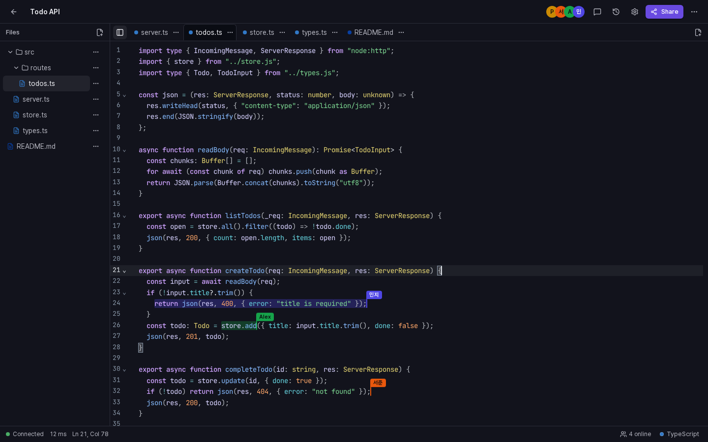
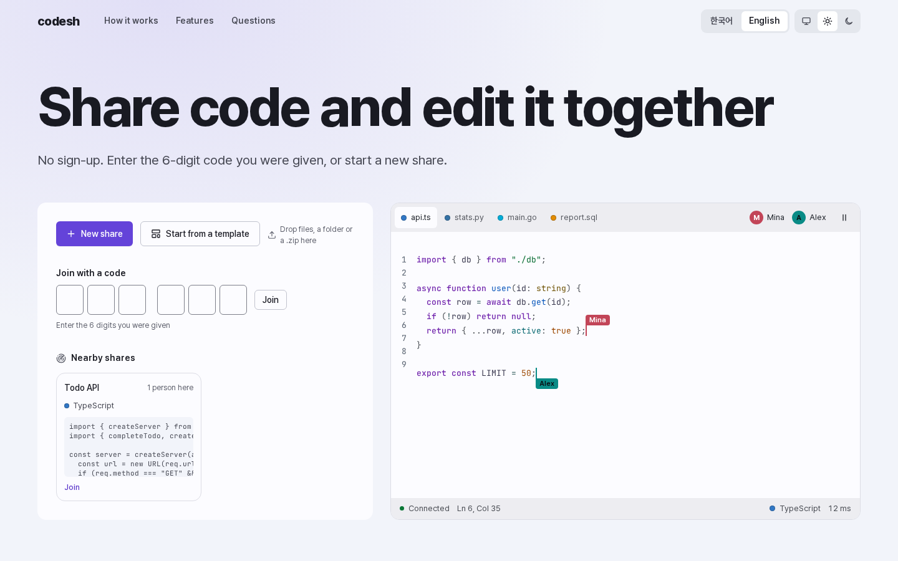
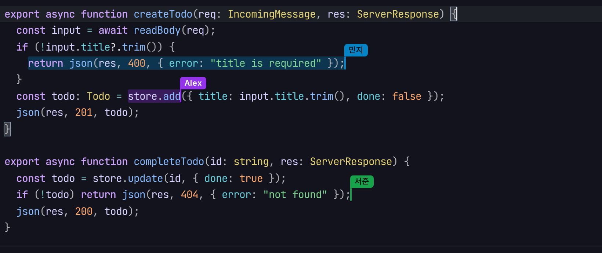
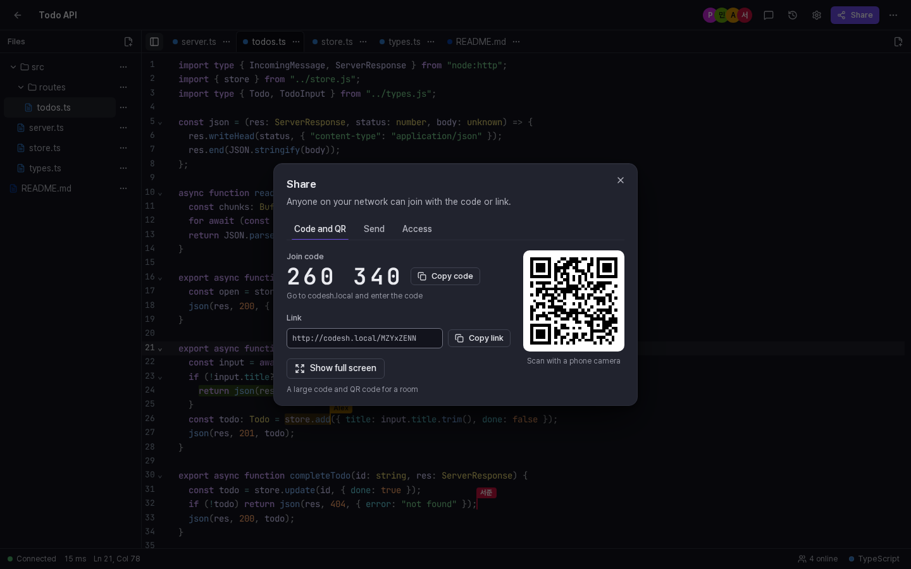
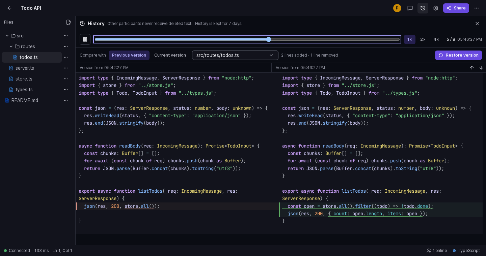
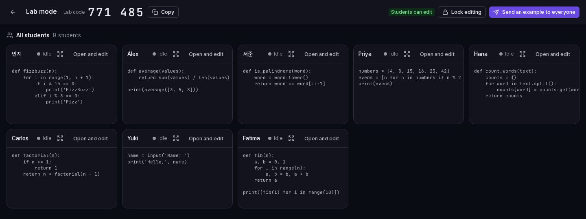
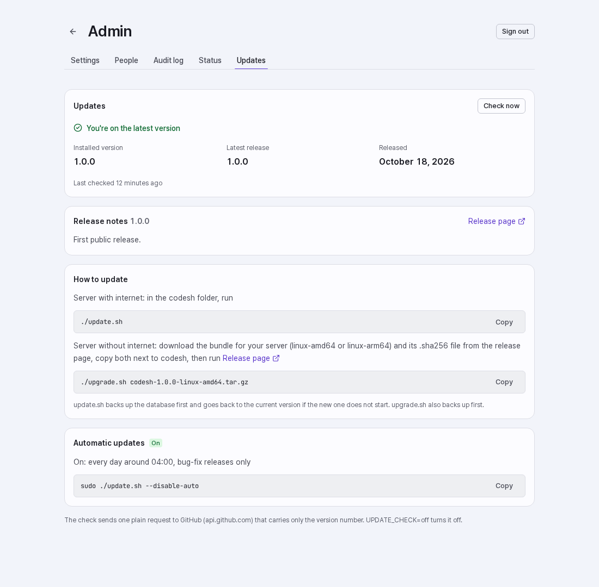
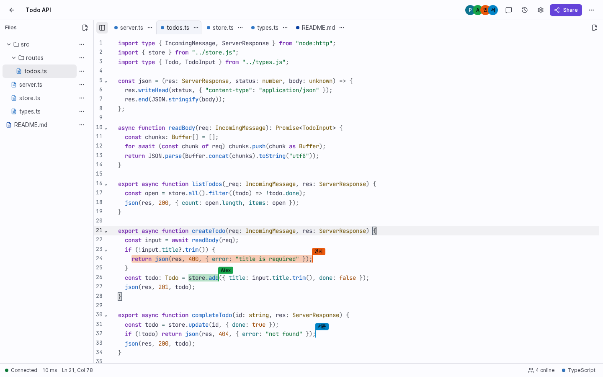
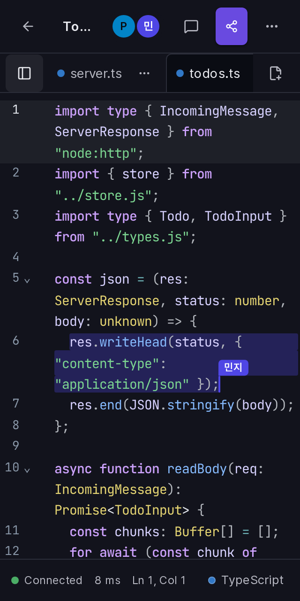
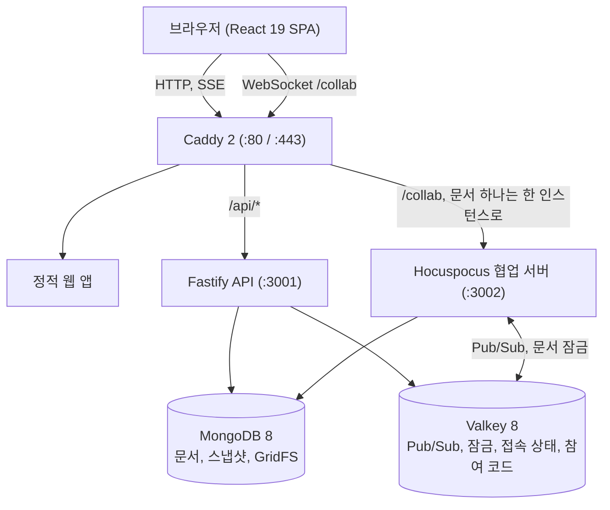

[English](README.md) | [한국어](README.ko.md)

# codesh

> 같은 네트워크에서 실시간으로 코드를 공유하고 함께 편집하는 셀프 호스팅 서비스

codesh는 같은 네트워크에 있는 사람들이 브라우저에서 코드를 공유하고 함께 편집하게 해 주는 서비스입니다. 회원가입도, 외부 클라우드도, 분석 스크립트도, CDN도 없습니다. 글꼴, 아이콘, 스크립트를 모두 내 서버에서 내려 주므로 인터넷이 끊긴 환경이나 폐쇄망에서도 그대로 동작합니다. 편집은 충돌 없이 합쳐지고(Yjs CRDT), 언어마다 문법 강조가 되며, 실습실 모드에서는 강사가 수강생 전원의 에디터를 한 화면에서 볼 수 있습니다.



## 스크린샷

| | |
|---|---|
|  |  |
|  |  |
|  |  |
|  |  |

## 할 수 있는 일

### 공유와 입장
- **바로 만드는 공유**: 클릭 한 번으로 8자리 영숫자 주소(`/<id>`)와 6자리 숫자 참여 코드(`/<code>`)가 생깁니다. 가입은 필요 없습니다.
- **원하는 방식으로 입장**: 6자리 코드를 입력하거나, 링크를 열거나, QR 코드를 찍습니다. QR 코드는 브라우저가 직접 그리며 프로젝터용 전체 화면도 있습니다.
- **근처 공유**: 같은 서브넷, 또는 관리자가 정한 방에 열려 있는 공유가 시작 화면에 나타납니다.
- **보내기와 띄우기**: 접속 중인 사람에게 최대 200자 메모와 함께 공유를 보내거나, 방 전체에 초대를 띄웁니다.

### 함께 편집
- **충돌 없는 편집**: Yjs와 Hocuspocus가 동시 입력을 합칩니다. 연결이 끊긴 동안의 편집도 다시 연결되면 합쳐집니다.
- **커서와 따라가기**: 모든 참여자의 커서와 선택 영역에 색과 이름이 붙고, 참여자를 눌러 그 사람의 화면을 따라갈 수 있습니다.
- **여러 파일과 폴더**: 공유 하나에 파일 100개까지, 경로(`src/index.ts`)로 폴더를 만들고 파일 이름으로 언어를 알아냅니다.
- **200개 이상의 언어**: 네 가지 에디터 테마(Slate, Graphite, Paper, Sand)로 문법을 강조하며 모든 토큰 색은 WCAG 2.2 AA 대비를 지킵니다. 기본, Vim, Emacs, Sublime 키맵을 고를 수 있습니다.
- **줄에 붙는 코멘트**: 줄이나 범위에 코멘트를 달면 글이 바뀌어도 제자리를 지킵니다.
- **업로드와 다운로드**: 파일, 폴더, `.zip`을 창에 끌어다 놓고, 파일 하나 또는 전체를 `.zip`으로 내려받습니다.
- **정리와 빠른 시작**: 내 공유에서 폴더와 태그(공유당 10개까지)로 정리하고, 기본 템플릿 16개와 관리자가 추가한 템플릿으로 시작합니다.

### 이력
- **자동 스냅샷**: 편집 중 약 30초마다, 공유당 최대 100개, 기본 7일 보관합니다.
- **재생과 비교**: 1배속, 2배속, 4배속으로 재생하고 어느 시점이든 직전 버전이나 현재와 비교합니다.
- **안전한 복원**: 복원도 일반 편집으로 기록되어 이력이 지워지지 않습니다.
- **지운 내용은 비공개**: 참여자는 문서의 현재 상태만 받습니다. 지워진 내용은 서버에만 남고 소유자만 이력에서 볼 수 있습니다.

### 실습실
- **실습실 세션**: `/lab/new`로 6자리 코드의 실습실을 만들면 수강생마다 개인 복사본이 생깁니다.
- **실시간 격자**: 수강생 전원의 접속 상태와 코드를 한눈에 보고, 카드를 크게 보거나 그 에디터에 들어가 도와줄 수 있습니다.
- **예제 배포**: 내 공유 하나를 버튼 한 번으로 모든 수강생 작업 공간에 보냅니다.
- **편집 잠금**: 설명하는 동안 모든 수강생의 에디터를 읽기 전용으로 잠급니다.

### 권한과 개인정보
- **보기 전용 링크**: 보기 전용 링크를 나누고, 믿을 만한 사람에게만 별도의 편집 링크를 줍니다. 편집 링크는 `#key=…`로 끝나며 브라우저는 이 부분(프래그먼트)을 서버로 보내지 않습니다. codesh는 이 키를 주소창에서 곧바로 지웁니다. 예전 `?key=` 링크도 열리고 같은 방식으로 정리됩니다.
- **PIN 잠금**: 4~32자 PIN을 scrypt 해시로 저장하고, 5번 틀리면 10분간 입장이 막힙니다.
- **대기실**: 새로 들어오려는 사람을 소유자가 승인해야 입장합니다.
- **내보내기와 차단**: 사람을 내보내거나, 클라이언트와 네트워크 주소 기준으로 차단합니다.
- **내가 정하는 오프라인 사본**: 연결이 끊겨도 입력이 사라지지 않도록 브라우저가 오프라인 사본을 보관합니다. 여럿이 쓰는 기기에서는 설정에서 끄거나(이미 저장된 이 공유의 사본도 바로 지워집니다) **이 기기에서 지우기**를 누르면 이 공유의 사본과 저장된 편집 키가 열려 있는 모든 탭에서 지워집니다. 공유에서 내보내지거나 차단됐을 때, 입장 권한이 거부됐을 때, 공유가 삭제됐을 때, 로그아웃하거나 계정을 바꿀 때도 사본이 자동으로 지워집니다.
- **런타임에 밖으로 나가는 것이 없음**: 외부 글꼴, CDN, 분석 도구, 외부 위젯이 없습니다. 아래 업데이트 확인이 유일한 선택 사항이며 끌 수 있습니다.

### 터미널 CLI
CLI는 `packages/cli`에 있으며 이 저장소에서 빌드합니다(`pnpm --filter @codesh/cli build`).
- `codesh push <파일…>`: 파일, 폴더, 표준 입력을 공유하고 URL, 참여 코드, QR 코드를 출력합니다.
- `codesh open <코드|id>`: 공유를 브라우저로 엽니다.
- `codesh pull <코드|id>`: 공유를 파일이나 `.zip`으로 내려받습니다. 잠긴 공유는 `--pin`을 씁니다.

### 관리
- **콘솔**(`/admin`, 관리자 토큰): 공유 유지 시간, 이력 보관, 업로드 크기, 게스트 허용 같은 설정과 근처 공유용 방, 사용자 템플릿.
- **선택적 로그인**: OIDC 또는 LDAP. 게스트는 계속 허용할 수 있습니다.
- **감사 로그, 사용자, 상태, 업데이트** 탭.

## 사용 방법

1. **시작**: 첫 화면에서 **새 공유**를 누르거나 **템플릿으로 시작**을 고릅니다.
2. **초대**: **공유**(Mac `⌃⌘S`, Windows·Linux `Ctrl+Alt+S`)를 눌러 링크를 복사하거나 6자리 코드와 QR 코드를 보여 줍니다.
3. **입장**: 첫 화면에 코드를 입력하거나 `/<코드>` 또는 `/<id>`를 엽니다.
4. **함께 편집**: 실시간 커서, 문법 강조, 코멘트(`⌃⌘M` / `Ctrl+Alt+M`)를 씁니다.
5. **파일 관리**: 파일 패널에서 파일과 폴더를 추가하거나 파일과 `.zip`을 창에 끌어다 놓습니다.
6. **이력 보기**: 소유자는 **이력**(`⌃⌘H` / `Ctrl+Alt+H`)을 엽니다.
7. **내보내기**: 파일 하나 또는 전체를 `.zip`으로 내려받습니다.

입력 칸 밖에서 `?`를 누르면 지금 운영체제에 맞는 단축키가 나옵니다. 전체 목록은 [사용자 안내서](docs/USER-GUIDE.md)에 있습니다.

| 동작 | Mac | Windows / Linux |
|---|---|---|
| 명령 팔레트 | `⌘ K` 또는 `F1` | `Ctrl + K` 또는 `F1` |
| 공유 창 | `⌃ ⌘ S` | `Ctrl + Alt + S` |
| 설정 | `⌘ ,` | `Ctrl + ,` |
| 코멘트 | `⌃ ⌘ M` | `Ctrl + Alt + M` |
| 이력 (소유자) | `⌃ ⌘ H` | `Ctrl + Alt + H` |
| 전체 코드 복사 | `⌃ ⌘ C` | `Ctrl + Alt + C` |
| 코드 정리 | `⇧ ⌥ F` | `Shift + Alt + F` |
| 찾기 / 찾아 바꾸기 | `⌘ F` / `⌘ ⌥ F` | `Ctrl + F` / `Ctrl + H` |
| 윗줄 / 아랫줄에 커서 추가 | `⌘ ⌥ ↑` / `⌘ ⌥ ↓` | `Ctrl + Alt + ↑` / `Ctrl + Alt + ↓` |
| 같은 단어 다음 항목 선택 | `⌘ D` | `Ctrl + D` |

## 설치

Docker Engine과 Docker Compose 플러그인(`docker compose`)이 있는 Linux 서버면 됩니다. 밖으로 열리는 포트는 Caddy의 HTTP(80)와 HTTPS(443)뿐입니다.

| 규모 | 최소 | 권장 | 메모 |
|---|---|---|---|
| 한 공유 50명 | 2 vCPU, 4 GB RAM, SSD 20 GB | 4 vCPU, 8 GB RAM | RAM 4 GB에서는 `MONGO_CACHE_GB=1` |
| 동시 약 200명 (수업, 실습, 소그룹) | 4 vCPU, 8 GB RAM, SSD 40 GB | 8 vCPU, 16 GB RAM | collab 하나로 충분하며 약 400명부터 `COLLAB_REPLICAS=2` |

### 인터넷이 되는 서버: Docker Compose

```sh
git clone https://github.com/kim0040/codesh.git && cd codesh/deploy
cp .env.example .env && ./generate-secrets.sh     # 한 번만. .env는 서버에만 둡니다
docker compose pull && docker compose up -d       # ghcr.io/kim0040의 공개 이미지
curl http://localhost/healthz
```

### 인터넷이 없는 서버: 오프라인 번들

인터넷이 되는 PC에서 [GitHub 릴리스](https://github.com/kim0040/codesh/releases)의 `codesh-<버전>-linux-amd64.tar.gz`(또는 `-linux-arm64`)와 `.sha256` 파일을 받아 서버로 옮긴 뒤 실행합니다.

```sh
sha256sum -c codesh-<버전>-linux-amd64.tar.gz.sha256
tar xzf codesh-<버전>-linux-amd64.tar.gz && cd codesh-<버전>-linux-amd64
PUBLIC_URL=http://codesh.local ./install.sh       # 이미지 로드, 새 비밀키로 .env 작성, 시작, /healthz 대기
```

`install.sh`는 이미지를 올리기 전에 번들 안의 `SHA256SUMS`로 모든 파일을 검사합니다. 체크섬은 서명이 아닙니다. `.sha256` 값은 번들과 다른, 믿을 수 있는 경로로 받은 값과 대조하십시오. 릴리스 파일에는 빌드 출처 증명도 붙습니다(`gh attestation verify`, [RELEASING.md](RELEASING.md)). 번들에는 codesh 이미지와 함께 변경하지 않은 공식 MongoDB, Valkey, Caddy, Node 이미지와 `backup.sh`, `restore.sh`, `upgrade.sh`, `update.sh`가 들어 있습니다.

오프라인 설치를 올릴 때는 새 번들과 `.sha256` 파일을 같은 폴더에 두고 `./upgrade.sh ../codesh-<새 버전>-linux-amd64.tar.gz`를 실행합니다. 체크섬 검사, 데이터베이스 백업, 이미지 로드를 하고 `.env`는 그대로 둡니다.

### HTTPS

`SITE_ADDRESS=:80`이면 일반 HTTP입니다. `codesh.local` 같은 호스트 이름을 쓰면 `deploy/tls/*.caddy`에 `tls` 줄이 필요합니다. Caddy 내장 CA는 `tls internal`, 직접 만든 인증서는 인증서와 키 경로를 적습니다. 없으면 Caddy가 공개 ACME CA에 접속하려 하고, 인터넷이 없는 네트워크에서는 실패합니다. 일반 HTTP는 네트워크를 볼 수 있는 사람에게 문서 내용과 인증 정보를 그대로 보여 주므로, 공용 네트워크에서는 HTTPS를 쓰십시오. 자세한 절차와 클라이언트 CA 신뢰 방법은 [deploy/tls/README.md](deploy/tls/README.md)에 있습니다.

백업, 확장, 모니터링, `.env` 설정 전체는 [운영자 안내서](docs/OPERATIONS.md)와 [deploy/README.md](deploy/README.md)에 있습니다.

## 업데이트

- **릴리스 확인**: `UPDATE_CHECK=on`(기본값)이면 API가 시작하고 몇 분 뒤, 그 뒤로 약 12시간마다 `GET https://api.github.com/repos/<UPDATE_REPO>/releases/latest` 요청 하나를 보냅니다. codesh가 밖으로 보내는 유일한 요청이며, 쿠키·식별자·사용 통계를 보내지 않고 요청 처리를 막지 않으며 인터넷이 없으면 5초 안에 조용히 실패합니다. `.env`의 `UPDATE_CHECK=off`로 완전히 끌 수 있습니다. 새 릴리스는 관리 콘솔에 표시됩니다.
- **되돌리기가 있는 수동 업데이트** (설치된 번들 폴더에서):
  ```sh
  ./update.sh --check              # 설치된 버전과 최신 릴리스 비교, 아무것도 바꾸지 않음
  ./update.sh                      # 체크섬, DB 백업, 이미지 받기, /healthz·/readyz 확인, 실패하면 되돌림
  ./update.sh --bundle <경로>      # 오프라인 번들 적용
  ```
- **자동 업데이트** (기본 꺼짐):
  ```sh
  sudo ./update.sh --enable-auto --at 04:00 --policy patch   # 또는 --policy minor
  sudo ./update.sh --disable-auto
  ```
  systemd 타이머(없으면 cron)가 정한 종류의 릴리스를 적용합니다. 메이저 버전은 자동으로 설치하지 않습니다.
- 관련 서비스는 모두 무료입니다. 공개 저장소, 공개 GHCR 패키지, 빌드 출처 증명이 있는 GitHub Actions, 인증 없는 GitHub API를 씁니다. 운영 세부는 [운영자 안내서 15장](docs/OPERATIONS.md), 릴리스 절차는 [RELEASING.md](RELEASING.md)에 있습니다.

## 동작 원리



- **Yjs와 Hocuspocus**: 편집은 WebSocket으로 오가며 결정적으로 합쳐집니다. 폴링이 없습니다.
- **수평 확장**: `collab` 복제본 여러 개가 Valkey(문서 잠금 `doclock:<id>`, 권한·명령 채널)로 조율하고, Caddy는 한 문서의 연결을 같은 복제본으로 보냅니다.
- **저장**: 살아 있는 Y.Doc은 메모리에 있어 편집이 데이터베이스를 기다리지 않습니다. 100 ms마다 묶어서 MongoDB에 쓰고 200개 업데이트마다 스냅샷으로 압축합니다. 업로드는 MongoDB GridFS에 있습니다.
- **지운 내용 보호**: 서버는 Yjs를 `gc: true`로 돌리고 입장하는 클라이언트에 현재 상태만 보내므로 지운 내용은 참여자에게 전송되지 않습니다.
- **오프라인**: 브라우저가 `y-indexeddb`로 문서를 보관했다가 연결이 돌아오면 합칩니다(기기별로 끌 수 있음).
- **셀프 호스팅**: Pretendard와 JetBrains Mono 글꼴, 아이콘, 모든 스크립트가 이미지 안에 있습니다.

**4 vCPU / 8 GB VM 한 대에서 잰 결과** (루프백 네트워크, 부하 생성기가 같은 머신에서 동작. 세부는 [운영자 안내서 11장](docs/OPERATIONS.md)):
- 한 공유 50명: 편집 지연 p95 약 10.6 ms, 커서 p95 약 33 ms(커서는 30 ms 창으로 묶어 보냅니다), 유실·중복 0건, 모든 복제본 수렴.
- 수업, 실습, 소그룹이 섞인 동시 약 200명: 편집 p95 약 31 ms, 유실 0건.
- 재접속 폭주: 한 공유의 연결 50개가 한꺼번에 끊겨도 1초 안에 다시 동기화됩니다(p95 0.6초, VM이 포화일 때 0.8초). collab 재시작 뒤에는 약 4초 안입니다. 어느 실행에서도 업데이트가 유실되지 않았습니다.

## 개발

Node.js 22 이상, pnpm 9.15(`corepack enable`), Docker와 Compose가 필요합니다.

```sh
pnpm install
pnpm services:up      # 개발용 MongoDB 8, Valkey 8
pnpm dev              # 웹 :5173, API :3001, collab :3002
pnpm check            # Biome, TypeScript 타입 검사, Vitest, 라이선스 검사
pnpm test:e2e         # Playwright. 먼저: pnpm --filter @codesh/web exec playwright install chromium
pnpm services:down
```

저장소는 pnpm과 Turborepo 모노레포(`apps/web`, `apps/api`, `apps/collab`, `packages/*`)이며 구조는 [docs/ARCHITECTURE.md](docs/ARCHITECTURE.md)에 있습니다. 위 스크린샷은 `apps/web/e2e/readme-shots.spec.ts`로 만듭니다. 기여는 환영합니다. [CONTRIBUTING.md](CONTRIBUTING.md)를 보십시오.

## 보안

- PIN은 scrypt로 해시해 상수 시간으로 비교하고, 반복해서 틀리면 해당 주소를 10분간 막습니다.
- 대기실, 내보내기와 차단(클라이언트·네트워크 주소 기준), 서버로 보내지 않는 URL 프래그먼트에 담았다가 주소창에서 지우는 편집 키와 보기 전용 링크.
- 브라우저 방어: Content Security Policy, `nosniff`, 프레임 거부, 그리고 상태를 바꾸는 모든 API 요청에 요구하는 `X-Codesh: 1` 헤더(또는 같은 출처의 `Origin`)로 외부 사이트의 폼 전송을 막습니다.
- API와 collab은 `codesh` 데이터베이스에만 `readWrite` 권한이 있는 `codesh_app`으로 MongoDB에 접속합니다. root 계정은 초기화와 백업 스크립트만 씁니다.
- API 호출, 참여 코드 입력, 공유 생성, 로그인에 주소별 속도 제한이 있으며 IPv6는 /64 단위로 함께 셉니다.

취약점은 공개하지 말고 비공개로 알려 주십시오. [SECURITY.md](SECURITY.md)를 보십시오.

## 문서

- [사용자 안내서](docs/USER-GUIDE.md): 공유, 편집, 권한, 실습실, 설정, 단축키, 문제 해결
- [운영자 안내서](docs/OPERATIONS.md): 요구사항, 오프라인 설치, 설정, TLS, 확장, 백업, 모니터링, 용량, 업데이트
- [아키텍처](docs/ARCHITECTURE.md): 구성, 데이터 모델, 협업 프로토콜, 보안 설계 (영어)
- [배포](deploy/README.md): 이미지, Compose, Caddy, 번들, 업데이트 (영어)
- [릴리스](RELEASING.md): 버전, 릴리스 워크플로, 릴리스 검증 (영어)
- [변경 기록](CHANGELOG.md)

## 라이선스

[MIT 라이선스](LICENSE)로 배포합니다. 사용한 라이브러리, 글꼴, 베이스 이미지는 [서드파티 고지](THIRD_PARTY_NOTICES.md)를 보십시오. MongoDB Community Server(SSPL)는 수정 없이 내부 데이터베이스로만 쓰며, 이 저장소에 포함되지 않습니다. 오프라인 번들에는 변경하지 않은 공식 이미지가 들어 있습니다.

## 기여자

김현민 (mini0227kim@gmail.com)
