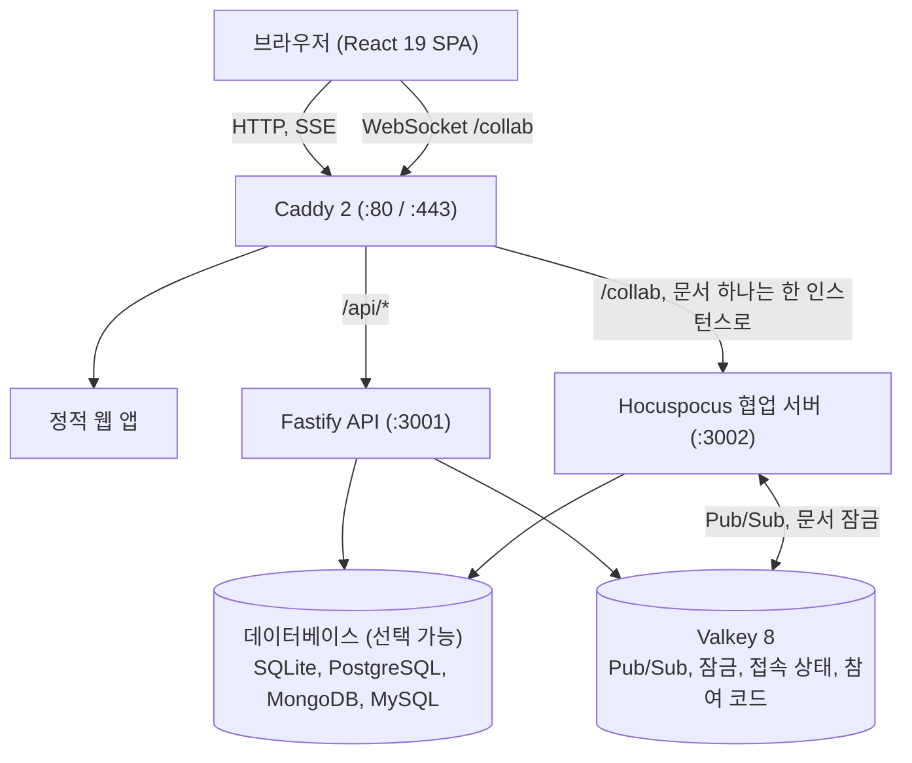

<p align="center">
  
</p>

<h1 align="center">gachipad</h1>

<p align="center">
  내부망이나 공개 인터넷에서 직접 호스팅하는 실시간 코드 공유 서비스
</p>

<p align="center">
  <a href="https://github.com/kim0040/gachipad/actions/workflows/ci.yml"></a>
  <a href="https://github.com/kim0040/gachipad/releases"></a>
  <a href="LICENSE"></a>
</p>

<p align="center">
  <a href="README.md">English</a> · <a href="README.ko.md">한국어</a>
  <br />
  <a href="#빠른-시작">빠른 시작</a> · <a href="#주요-기능">주요 기능</a> · <a href="#설치">설치</a> · <a href="#동작-원리">동작 원리</a> · <a href="#문서">문서</a>
</p>


## 왜 gachipad인가요?

- **회원가입 없음, 서드파티 에셋 및 추적 없음**: 모든 글꼴, 아이콘, 스크립트를 자체 서버에서 제공하며 인터넷 없이도 동작합니다. 외부 요청은 선택 사항인 릴리스 확인과 공개 직접 모드의 ACME뿐입니다.
- **내부망 및 공개 인터넷 모드**: 내부망 모드(일반 HTTP 또는 내부 CA HTTPS, mDNS)와 공개 인터넷 모드(ACME 자동 TLS/HSTS, 클라이언트 격리, 엄격한 요청 한도)를 설치 시 선택할 수 있습니다.
- **명령어 한 줄 설치**: 사전 점검과 함께 Linux에서는 `./install.sh`, Windows에서는 `install.cmd`(WSL 2 및 Docker Desktop)로 즉시 설치할 수 있습니다.
- **충돌 없는 실시간 협업**: Yjs CRDT로 동시 입력을 결정론적으로 병합하며, 삭제된 텍스트는 가비지 컬렉션(`gc: true`)되어 다른 참여자에게 전송되지 않습니다.
- **수업 및 실습실 모드**: 실시간 격자 화면(`/lab/new`)으로 수강생 전원의 코드를 한눈에 살펴보고, 예제 코드를 일괄 배포하거나 설명을 위해 편집을 일시 잠글 수 있습니다.
- **검증된 성능**: 4 vCPU / 8 GB VM 1대에서 한 공유 50명 동시 편집 시 p95 편집 지연 10.6 ms, 커서 지연 33 ms 및 200명 동시 접속 시 유실 0건을 확인했습니다.

## 빠른 시작

### Linux (인터넷 연결 환경)

```sh
git clone https://github.com/kim0040/gachipad.git && cd gachipad/deploy
./install.sh --check
./install.sh
```

무인 설치 옵션(`--yes`) 및 네트워크 모드 스위치는 [설치](#설치) 섹션을 참고하십시오.

### Linux (인터넷 없는 오프라인 환경)

```sh
tar xzf gachipad-<버전>-linux-amd64.tar.gz && cd gachipad-<버전>-linux-amd64
./install.sh
```

체크섬 검증, mDNS 설정 및 오프라인 업그레이드 방법은 [설치](#설치) 섹션을 참고하십시오.

### Windows (WSL 2)

```cmd
git clone https://github.com/kim0040/gachipad.git
cd gachipad\deploy
install.cmd
```

`install.cmd`는 git clone 저장소의 `deploy\` 폴더 또는 압축을 푼 릴리스 번들 폴더에 있습니다. `install.ps1 -BundlePath <archive.tar.gz>`로 다운로드한 번들 아카이브를 직접 전달할 수도 있습니다. WSL 2 및 Docker Desktop 환경에서 실행되며, PowerShell 스위치 및 방화벽 설정은 [설치](#설치) 섹션을 참고하십시오.

## 스크린샷

| | |
|---|---|
|  |  |
|  |  |
|  |  |
|  |  |

## 주요 기능

### 공유와 참여
- **즉시 생성**: 회원가입 없이 클릭 한 번으로 8자리 ID(`/<id>`) 및 6자리 참여 코드(`/<code>`)를 생성합니다.
- **다양한 참여 방식**: 6자리 참여 코드 입력, 직접 링크 접속, 프로젝터 전체 화면을 지원하는 인브라우저 QR 코드 스캔으로 참여합니다.
- **근처 공유 탐색**: 같은 서브넷이나 관리자가 설정한 방에 열려 있는 공유를 시작 화면에서 바로 탐색합니다.
- **초대 및 전체 안내**: 접속 중인 사용자에게 최대 200자 메모와 함께 공유를 직접 전달하거나 방 전체에 안내를 표시합니다.

### 함께 편집
- **충돌 없는 실시간 동기화**: Yjs 및 Hocuspocus를 통해 동시 입력을 자동으로 병합하며 연결 복구 시 오프라인 변경 사항도 안전하게 합쳐집니다.
- **커서 및 화면 따라가기**: 참여자별 고유 색상 커서와 이름표, 실시간 화면 따라가기, 로컬 리듬을 해치지 않는 안정적인 커서 깜빡임을 제공합니다.
- **부드러운 입력감**: 100ms 감속 곡선 이동과 부드러운 페이드 깜빡임을 지원하며 동작 줄이기 설정 시 고정 커서로 전환됩니다.
- **자동 완성 및 언어 감지**: 키워드 및 문서 내 단어 자동 완성(Tab 입력), 일반 텍스트 입력 중 자동 언어 감지 제안을 지원합니다.
- **다중 파일 작업 공간**: 폴더 경로(`src/index.ts`) 기반으로 공유당 최대 100개 파일을 구성하며 파일 확장자에서 언어를 자동 감지합니다.
- **200개 이상 언어 및 테마**: 200개 이상 언어 문법 강조, WCAG 2.2 AA 명도 대비를 만족하는 4개 테마, Vim/Emacs/Sublime 키맵을 제공합니다.
- **줄에 붙는 코멘트**: 코드 수정 시에도 위치를 유지하는 범위 앵커 코멘트로 코드 위에서 바로 토론합니다.
- **파일 업로드 및 내보내기**: 파일, 폴더, `.zip` 파일을 에디터 창에 끌어다 놓을 수 있고, 개별 파일 또는 공유 전체를 `.zip`으로 내려받습니다.
- **정리 및 템플릿**: 폴더와 태그(공유당 최대 10개)로 코드를 분류하고 16개 기본 템플릿 또는 관리자 템플릿으로 빠르게 시작합니다.

### 이력
- **자동 스냅샷**: 편집 활동 약 30초마다 스냅샷을 생성하여 공유당 최대 100개(기본 7일)를 보관합니다.
- **재생 및 비교**: 1배속, 2배속, 4배속 이력 재생과 직전 버전 및 현재 상태와의 나란한 비교를 지원합니다.
- **안전한 복원 및 삭제 텍스트 보호**: 이전 버전 복원은 새 편집으로 안전하게 기록되며 삭제된 텍스트는 다른 참여자에게 전송되지 않습니다.

### 수업 및 실습실
- **실습실 세션**: `/lab/new`에서 6자리 코드로 개설하여 각 학생에게 독립된 개인 복사본을 자동 제공합니다.
- **실시간 격자 모니터링**: 강사는 전체 수강생의 코드를 실시간 격자로 확인하고 특정 카드를 확대하거나 직접 들어가 지도합니다.
- **예제 일괄 배포 및 편집 잠금**: 강사의 작업 공간을 학생 전체에 한 번에 배포하고 설명 중에는 학생 에디터를 읽기 전용으로 잠급니다.

### 권한과 보안
- **보기 전용 링크 분리**: 편집 링크의 `#key=...` 프래그먼트는 서버로 전송되지 않으며 접속 즉시 주소창에서 제거됩니다.
- **세부 권한 및 PIN 잠금**: 이름 변경, 파일 수정 권한을 서버에서 강제하며 4~32자리 scrypt 해시 PIN(5회 실패 시 10분 차단)을 지원합니다.
- **대기실 및 차단**: 신규 참여자 승인 대기실, 즉시 퇴장 및 클라이언트 ID·네트워크 주소 기반 차단을 제공합니다.
- **기기별 로컬 저장 제어**: 명시적 저장 동의("이 기기에 저장"), "이 기기에서 지우기"를 통한 즉시 삭제, 민감 정보가 제외된 로컬 진단 내보내기를 지원합니다.
- **네트워크 격리**: 외부 글꼴, CDN, 분석 도구가 없으며 모든 리소스는 자체 서버에서 직접 제공됩니다.

### 안내 및 둘러보기
- **온보딩 둘러보기**: 에디터 첫 방문 대화형 튜토리얼(설정에서 재실행 가능) 및 `/guide` 상세 웹 가이드를 제공합니다.

### 터미널 CLI
- `packages/cli` 기반(`pnpm --filter @gachipad/cli build`)으로 `push`, `open`, `pull`(--pin 지원) 명령을 제공합니다.

### 관리자
- **관리자 콘솔**(`/admin`): 공유 수명, 보관 주기, 업로드 용량, 게스트 접근, 방, 템플릿을 제어하며 `ADMIN_ALLOW_CIDR` 및 속도 제한으로 보호됩니다.
- **인증 연동 및 운영 탭**: 게스트 접근과 병행 가능한 OIDC/LDAP 연동, 실시간 지표, 감사 로그, 백업 및 업데이트 패널을 제공합니다.

## 사용 방법

1. **시작하기**: 첫 화면에서 **새 공유**를 누르거나 **템플릿으로 시작**을 선택해요.
2. **초대하기**: **공유** 버튼(Mac `⌃⌘S`, Windows·Linux `Ctrl+Alt+S`)을 눌러 링크를 복사하거나, 6자리 참여 코드 또는 QR 코드를 보여줘요.
3. **참여하기**: 첫 화면에 코드를 입력하거나 `/<코드>` 또는 `/<id>` 주소를 열어요.
4. **함께 편집하기**: 실시간 커서, 문법 강조, 인라인 코멘트(`⌃⌘M` / `Ctrl+Alt+M`)를 사용해 코드를 작성해요.
5. **파일 관리하기**: 파일 탐색기 패널에서 파일과 폴더를 추가하거나, 파일 및 `.zip` 파일을 에디터 창에 끌어다 놓아요.
6. **이력 확인하기**: 공유 소유자는 **이력** 메뉴(`⌃⌘H` / `Ctrl+Alt+H`)에서 스냅샷과 차이점을 확인하고 복원할 수 있어요.
7. **내보내기**: 파일 하나를 내려받거나 전체 코드를 `.zip` 압축 파일로 저장해요.

입력창 바깥에서 `?`를 누르면 현재 운영체제에 맞는 단축키 목록이 나와요. 전체 단축키 안내는 [사용자 안내서](docs/USER-GUIDE.md)에 있어요.

| 동작 | Mac | Windows / Linux |
|---|---|---|
| 명령 팔레트 | `⌘ K` 또는 `F1` | `Ctrl + K` 또는 `F1` |
| 공유 창 | `⌃ ⌘ S` | `Ctrl + Alt + S` |
| 설정 | `⌘ ,` | `Ctrl + ,` |
| 코멘트 | `⌃ ⌘ M` | `Ctrl + Alt + M` |
| 이력 (소유자) | `⌃ ⌘ H` | `Ctrl + Alt + H` |
| 전체 코드 복사 | `⌃ ⌘ C` | `Ctrl + Alt + C` |
| 코드 정리 | `⇧ ⌥ F` | `Shift + Alt + F` |
| 찾기 / 찾아 바꾸기 | `⌘ F` / `⌘ ⌥ F` | `Ctrl + F` / `Ctrl + H` |
| 윗줄 / 아랫줄에 커서 추가 | `⌘ ⌥ ↑` / `⌘ ⌥ ↓` | `Ctrl + Alt + ↑` / `Ctrl + Alt + ↓` |
| 같은 단어 다음 항목 선택 | `⌘ D` | `Ctrl + D` |

## 설치

codesh 1.0.x에서 업그레이드하시나요? [운영자 안내서의 이름 변경 안내](docs/OPERATIONS.md#16-codesh에서-gachipad로-이름-변경-10x에서-업그레이드)를 참고하세요.

Docker Engine과 Docker Compose 플러그인(v2.20 이상)이 설치된 Linux 서버 또는 WSL 2와 Docker Desktop을 사용하는 64비트 Windows 10/11 환경에서 실행할 수 있습니다. 외부에 노출되는 포트는 Caddy의 HTTP(80)와 HTTPS(443)뿐입니다. 설치 전 `./install.sh --check`로 호스트 환경을 사전 점검할 수 있으며(호스트 설정 변경 없음), 대화형 확인 없이 무인 설치를 진행할 때는 `--yes`를 지정합니다.

| 규모 | 최소 | 권장 | 메모 |
|---|---|---|---|
| 한 공유 50명 | 2 vCPU, 4 GB RAM, SSD 20 GB | 4 vCPU, 8 GB RAM | RAM 4 GB에서는 `MONGO_CACHE_GB=1` |
| 동시 약 200명 (수업, 실습, 소그룹) | 4 vCPU, 8 GB RAM, SSD 40 GB | 8 vCPU, 16 GB RAM | collab 하나로 충분하며 약 400명부터 `COLLAB_REPLICAS=2` |

### 배포 모드 비교

| 항목 | 내부망 모드 (`--network internal`) | 공개 인터넷 모드 (`--network public`) |
|---|---|---|
| **HTTPS** | 일반 HTTP 또는 내부 HTTPS (Caddy 로컬 CA 또는 자체 인증서) | 자동 ACME TLS (Let's Encrypt / ZeroSSL) 또는 `--behind-proxy` |
| **mDNS (`gachipad.local`)** | 네이티브 Linux 기본 활성화 (`--no-mdns`로 해제) | 비활성화 |
| **관리자 콘솔 기본 접근** | 로컬 네트워크 접근 허용 (선택적 `ADMIN_ALLOW_CIDR`) | 루프백 및 사설 CIDR(`127.0.0.1`, RFC 1918)로 기본 제한 |
| **한도 및 할당량** | 여유 있는 내부망 한도 | 엄격한 IP별 속도 제한, 생성 할당량, 분당 300회 참여 코드 전역 실패 예산 |
| **운영자 준비 사항** | 내부 네트워크의 Docker 호스트 | 공용 도메인(A 레코드), 인바운드 80/443 포트 또는 TLS 프록시 CIDR |

공개 인터넷 모드는 HTTPS와 HSTS를 강제하고, mDNS를 끄며, 로컬 네트워크 정보 노출을 막기 위해 클라이언트 디스커버리 그룹을 격리하고 엄격한 남용 한도를 적용합니다. 공개 인터넷 직접 모드에서 추가로 발생하는 유일한 외부 네트워크 통신은 Caddy의 무료 ACME 인증서 발급·갱신 트래픽이며, 프록시 종단 공개 모드 및 내부망 모드는 추가 외부 요청을 일절 발생시키지 않습니다.

### 세부 설치 방법

- **인터넷 연결 Linux**: `git clone https://github.com/kim0040/gachipad.git && cd gachipad/deploy && ./install.sh`를 실행합니다. 인터넷 공개 호스팅에는 `--network public --domain share.example.org`를 추가하고, 외부 TLS 역방향 프록시 뒤에 둘 때는 `--behind-proxy <CIDR>`를 지정합니다. 수동 Docker Compose 명령은 [deploy/README.md](deploy/README.md)에 안내되어 있습니다.
- **인터넷 없는 Linux (오프라인 번들)**: [GitHub 릴리스](https://github.com/kim0040/gachipad/releases)에서 `gachipad-<버전>-linux-amd64.tar.gz`와 `.sha256` 파일을 받아 `sha256sum -c` 검증 후 압축을 풀고 `PUBLIC_URL=http://gachipad.local ./install.sh`를 실행합니다. 번들에는 공식 DB 및 인프라 이미지가 포함되어 있습니다. 네이티브 Linux에서는 mDNS가 기본 제공됩니다(`--no-mdns`로 제외 가능. [운영자 안내서(mDNS)](docs/OPERATIONS.md#5-mdns-gachipadlocal-옵션) 참고). 업그레이드는 `./upgrade.sh ../gachipad-<새버전>-linux-amd64.tar.gz`로 진행합니다.
- **Windows (WSL 2)**: `install.cmd` 또는 PowerShell에서 `.\deploy\install.ps1 -Network internal`을 실행합니다 (주요 스위치: `-Network`, `-Domain`, `-AcmeEmail`, `-BehindProxy`, `-Db`, `-DatabaseUrl`, `-Distro`, `-InstallDir`, `-OpenFirewall`, `-InstallWsl`, `-BundlePath`, `-InstallArgs`). 설치 후에는 `.\deploy\gachipad.ps1`(`update --check`, `backup`, `logs`)로 관리합니다. [운영자 안내서](docs/OPERATIONS.md#18-windows-환경-설치-및-운영-wsl-2)를 참고하십시오.
- **HTTPS 설정**: `SITE_ADDRESS=:80`이면 일반 HTTP로 동작합니다. 내부망에서 호스트 이름을 사용할 때는 `deploy/tls/*.caddy`에 `tls` 설정(Caddy 자체 CA `tls internal` 또는 준비한 인증서/키 경로)을 해야 하며, 설정이 없으면 인터넷이 없는 환경에서 실패합니다. [deploy/tls/README.md](deploy/tls/README.md)를 참고하십시오.
- **데이터베이스 선택**: **SQLite**(신규 설치 기본값, 공유 볼륨 `gachipad-data`에 WAL 모드로 저장, 메모리 사용 최소), **번들 PostgreSQL**(PostgreSQL 17, 다중 collab 확장 지원), **번들 MongoDB**(MongoDB 8, 1.0.x에서 무마이그레이션 승계), **외부 데이터베이스**(`DATABASE_URL`, `--db external`, PostgreSQL/MySQL/MariaDB/MongoDB 지원, MySQL·MariaDB는 외부 전용)를 지원합니다. Valkey 8은 모든 DB에서 필수입니다. 백업·복원 및 오프라인 마이그레이션은 [운영자 안내서](docs/OPERATIONS.md#9-데이터베이스-관리-및-업그레이드)를 참고하십시오.
- **업데이트**: `UPDATE_CHECK=on`(기본값)이면 API 시작 몇 분 후와 이후 약 12시간마다 `GET https://api.github.com/repos/<UPDATE_REPO>/releases/latest` 요청을 보냅니다. 내부망 모드나 프록시 종단 환경에서는 gachipad가 외부로 보내는 유일한 요청입니다(공개 인터넷 직접 모드에서는 ACME 인증서 통신이 추가됨). 쿠키나 사용 통계를 보내지 않고 다른 요청을 차단하지 않으며 인터넷이 없으면 5초 내 조용히 실패합니다(`.env`의 `UPDATE_CHECK=off`로 비활성화 가능). `./update.sh --check`(확인), `./update.sh`(자동 DB 백업 및 롤백 지원), `./update.sh --bundle <경로>`(오프라인 번들)로 업데이트하며 `sudo ./update.sh --enable-auto --policy patch`로 자동 업데이트를 설정할 수 있습니다. [운영자 안내서 15장](docs/OPERATIONS.md#15-업데이트)을 참고하십시오.

## 동작 원리



- **Yjs와 Hocuspocus**: 편집 데이터는 WebSocket으로 전달되며 CRDT를 통해 결정론적으로 병합됩니다. 주기적인 폴링이 없습니다.
- **수평 확장**: 여러 대의 `collab` 복제본이 Valkey(문서 잠금 `doclock:<id>`, 권한·명령 채널)를 통해 조율되며, Caddy는 한 문서의 모든 연결을 동일한 복제본으로 라우팅합니다.
- **저장소**: 실시간 Y.Doc은 메모리에 유지되어 편집 시 데이터베이스를 기다리지 않습니다. 100 ms마다 변경 사항을 데이터베이스에 쓰고 200개 업데이트마다 스냅샷으로 압축합니다. 업로드 파일은 SQL 백엔드(SQLite, PostgreSQL, MySQL/MariaDB)의 `uploads`/`upload_chunks` 테이블 또는 MongoDB의 GridFS에 보관됩니다.
- **삭제된 내용 보호**: 서버는 Yjs를 `gc: true`로 실행하여 새로 참여하는 클라이언트에게 현재 상태만 전송하므로, 삭제된 텍스트는 다른 참여자에게 전송되지 않습니다.
- **오프라인 지원**: 브라우저가 `y-indexeddb`로 문서를 로컬에 보관했다가 연결이 복구되면 자동으로 서버와 병합합니다(기기별 비활성화 가능).
- **완전한 자체 호스팅**: Pretendard 및 JetBrains Mono 글꼴, 아이콘, 모든 정적 스크립트가 컨테이너 이미지 안에 내장되어 있습니다.

**4 vCPU / 8 GB VM 1대에서 측정한 결과** (루프백 네트워크, 부하 생성기를 같은 머신에서 실행. 세부 내용은 [운영자 안내서 11장](docs/OPERATIONS.md#11-용량-목표와-부하-테스트-capacity)):
- 한 공유 50명 동시 편집: 편집 지연 p95 약 10.6 ms, 커서 p95 약 33 ms(커서는 30 ms 창으로 묶어 전송), 데이터 유실 및 중복 0건, 모든 복제본 수렴.
- 수업, 실습, 소그룹이 섞인 동시 약 200명: 편집 p95 약 31 ms, 유실 0건.
- 재접속 폭주: 한 공유의 연결 50개가 동시에 끊겨도 1초 안에 다시 동기화 완료(p95 0.6초, VM 부하 상태에서 0.8초). collab 재시작 뒤에는 약 4초 안에 복구. 모든 테스트에서 업데이트 유실이 발생하지 않았습니다.

## 보안

- PIN은 scrypt로 해시하여 상수 시간으로 비교하며, 5번 연속 실패 시 해당 주소를 10분간 차단합니다.
- 대기실 승인, 클라이언트 및 네트워크 주소 기준 내보내기와 차단, 서버로 전송되지 않는 URL 프래그먼트에 담아 접속 즉시 주소창에서 지우는 편집 키와 보기 전용 링크 분리를 제공합니다.
- 브라우저 보안: Content Security Policy, `nosniff`, 프레임 차단, 그리고 상태를 바꾸는 모든 API 요청에 대해 외부 사이트의 폼 전송을 방지하는 `X-Gachipad: 1` 헤더(또는 같은 출처의 `Origin`) 검증을 적용합니다.
- 최소 권한 데이터베이스 접근: API와 collab은 애플리케이션 전용 권한(해당 DB의 `readWrite`)으로 연결하며, 초기화 및 백업 스크립트만 관리자 자격 증명을 사용합니다.
- API 호출, 참여 코드 입력, 공유 생성, 로그인에 주소별 속도 제한이 적용되며 IPv6는 /64 대역 단위로 함께 계산합니다.
- **공개 인터넷 모드 보안 강화**: HTTPS 및 HSTS를 강제 적용하고, 관리자 콘솔을 루프백 및 사설 CIDR(`127.0.0.1`, RFC 1918)로 기본 제한하며, mDNS 비활성화, 클라이언트 디스커버리 그룹 격리, 분당 300회 전역 실패 예산(Valkey 기반)을 통한 분산 6자리 코드 스캔 방지를 적용합니다.

취약점을 발견하셨다면 비공개 채널로 제보해 주십시오. [SECURITY.md](SECURITY.md)를 확인해 주세요.

## 개발

Node.js 22 이상, pnpm 9.15(`corepack enable`), Docker와 Compose가 필요합니다.

```sh
pnpm install
pnpm services:up      # 개발용 MongoDB 8과 Valkey 8 실행
pnpm dev              # 웹 :5173, API :3001, collab :3002
pnpm check            # Biome, TypeScript 타입 검사, Vitest, 라이선스 검사
pnpm test:e2e         # Playwright. 먼저 pnpm --filter @gachipad/web exec playwright install chromium 실행
pnpm services:down
```

저장소는 pnpm과 Turborepo 기반 모노레포(`apps/web`, `apps/api`, `apps/collab`, `packages/*`)이며 구조는 [docs/ARCHITECTURE.md](docs/ARCHITECTURE.md)에 정리되어 있습니다. 위 스크린샷은 `apps/web/e2e/readme-shots.spec.ts`로 생성합니다. 프로젝트 기여는 언제나 환영합니다. [CONTRIBUTING.md](CONTRIBUTING.md)를 확인해 주세요.

## 문서

- [사용자 안내서](docs/USER-GUIDE.md): 공유, 편집, 권한, 실습실, 설정, 단축키, 문제 해결 (한국어, 영어 요약 포함)
- [운영자 안내서](docs/OPERATIONS.md): 시스템 요구 사양, 오프라인 설치, 설정, TLS, 확장, 백업, 모니터링, 용량, 업데이트 (한국어)
- [아키텍처](docs/ARCHITECTURE.md): 구성, 데이터 모델, 협업 프로토콜, 보안 설계 (영어)
- [배포](deploy/README.md): 이미지, Compose, Caddy, 번들, 업데이트 (영어)
- [릴리스](RELEASING.md): 버전, 릴리스 워크플로, 릴리스 검증 (영어)
- [변경 기록](CHANGELOG.md)

## 라이선스

[MIT 라이선스](LICENSE)로 배포합니다. 사용한 라이브러리, 글꼴, 베이스 이미지는 [서드파티 고지](THIRD_PARTY_NOTICES.md)를 보십시오. MongoDB Community Server(SSPL)는 수정 없이 선택적 번들 데이터베이스로 사용되며, 이 저장소의 일부가 아닙니다. 오프라인 번들에는 수정되지 않은 공식 이미지가 포함되어 있습니다. 공식 이미지(PostgreSQL, MongoDB, Valkey, Caddy, Node)는 데이터베이스 및 인프라 구성에 수정 없이 사용됩니다.

## 기여자

김현민 (mini0227kim@gmail.com)
