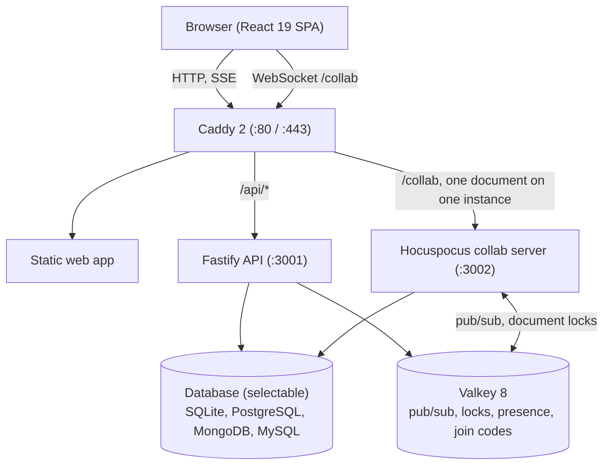

<p align="center">
  
</p>

<h1 align="center">gachipad</h1>

<p align="center">
  Real-time code sharing you host yourself, on an internal network or on the public internet.
</p>

<p align="center">
  <a href="https://github.com/kim0040/gachipad/actions/workflows/ci.yml"></a>
  <a href="https://github.com/kim0040/gachipad/releases"></a>
  <a href="LICENSE"></a>
</p>

<p align="center">
  <a href="README.md">English</a> · <a href="README.ko.md">한국어</a>
  <br />
  <a href="#quick-start">Quick start</a> · <a href="#features">Features</a> · <a href="#install">Install</a> · <a href="#how-it-works">How it works</a> · <a href="#documentation">Docs</a>
</p>


## Why gachipad

- **No accounts and zero outside requests**: Every font, icon, and script is served by your own server; runs without internet or in air-gapped environments.
- **Internal or public mode**: Deploy for an internal network (HTTP or internal CA HTTPS, mDNS) or the public internet (automated ACME TLS/HSTS, client discovery isolation, strict rate limits).
- **One-command installation**: Install and run preflight checks in one command on Linux (`./install.sh`) and Windows (`install.cmd` via WSL 2 and Docker Desktop).
- **Conflict-free collaborative editing**: Concurrent typing merges deterministically with Yjs CRDTs; deleted text is pruned (`gc: true`) and never transmitted to other participants.
- **Classroom and lab mode**: Instructors monitor every student in a real-time grid (`/lab/new`), push starter code in one click, and lock editing during lectures.
- **Measured performance**: Benchmarked on one 4 vCPU / 8 GB VM with 50 editors in one share (p95 edit latency 10.6 ms, cursor 33 ms) and 200 concurrent users without dropped updates.

## Quick start

### Linux (with internet)

```sh
git clone https://github.com/kim0040/gachipad.git && cd gachipad/deploy
./install.sh --check
./install.sh
```

For unattended installs (`--yes`) and network mode switches, see the [Install](#install) section.

### Linux (without internet)

```sh
tar xzf gachipad-<version>-linux-amd64.tar.gz && cd gachipad-<version>-linux-amd64
./install.sh
```

For checksum verification, mDNS options, and offline upgrades, see the [Install](#install) section.

### Windows (WSL 2)

```cmd
install.cmd
```

Runs inside WSL 2 with Docker Desktop; see the [Install](#install) section for PowerShell parameters and firewall settings.

## Screenshots

| | |
|---|---|
|  |  |
|  |  |
|  |  |
|  |  |

## Features

### Share and join
- **Instant shares**: Create a share in one click with an 8-character ID (`/<id>`) and a 6-digit join code (`/<code>`) without sign-up.
- **Join your way**: Enter the 6-digit code, open the direct link, or scan the browser-rendered QR code with full-screen projector mode.
- **Nearby shares**: Discover active shares on your subnet or in administrator-configured rooms directly on the start page.
- **Invitations**: Send share invitations with a note of up to 200 characters to online users, or broadcast them to the entire room.

### Collaborative editing
- **Conflict-free sync**: Concurrent typing merges automatically via Yjs and Hocuspocus; offline edits merge cleanly upon reconnect.
- **Presence and following**: Colored cursors and participant name tags with live view following and stable cursor blinking.
- **Smooth typing**: 100 ms decelerating caret gliding and smooth opacity fading (solid caret with reduced motion).
- **Code completion & language detection**: Keyword and word suggestions accepted with Tab, plus automatic language detection for plain text.
- **Multi-file workspaces**: Organize up to 100 files in folder paths (`src/index.ts`) with automatic language detection from file names.
- **200+ languages & themes**: Syntax highlighting for 200+ languages across four WCAG 2.2 AA compliant themes, with Vim, Emacs, and Sublime keymaps.
- **Anchored comments**: Attach discussions to a line or range that hold their place as surrounding code moves.
- **File handling**: Drag and drop files, folders, or `.zip` archives into the window; download individual files or export the share as a `.zip`.
- **Organization & templates**: Group shares with custom folders and up to 10 tags; start quickly with 16 built-in or custom templates.

### History
- **Automatic snapshots**: Snapshots captured roughly every 30 seconds of activity, saving up to 100 revisions per share (retained 7 days by default).
- **Playback and diff**: Play back history at 1x, 2x, or 4x speed, and compare any revision side-by-side with the previous or current text.
- **Safe restore & privacy**: Restores apply as new edits preserving full history; deleted text is never sent to other participants.

### Classroom and lab
- **Lab sessions**: Create sessions at `/lab/new` where each student receives an isolated personal workspace from a 6-digit code.
- **Live grid**: Instructors view every student's online status and editor in a live grid, zoom into individual tiles, or enter to assist.
- **Code distribution & edit lock**: Push an example share to all student workspaces in one click, and freeze student editors during explanations.

### Control and privacy
- **View-only links**: Edit links keep `#key=...` in the URL fragment (never sent to the server and stripped from the address bar immediately).
- **Permissions & PIN lock**: Server-enforced permissions for renaming and modifying files, plus 4–32 character scrypt PINs (5 failures lock out for 10 min).
- **Access control**: Waiting room for manual entry approval, immediate participant kick, and bans by client and network address.
- **Local data retention**: Explicit device storage choice ("Keep on this device"), complete deletion on "Forget", and bounded client diagnostics export.
- **Network isolation**: Zero external fonts, CDNs, or analytics; every script and asset is served strictly by your own server.

### Guides and tutorial
- **Onboarding & docs**: First-run spotlight tour (replayable from Settings) and comprehensive in-app documentation under `/guide`.

### Terminal CLI
- Built from `packages/cli` (`pnpm --filter @gachipad/cli build`) with `push`, `open`, and `pull` (with `--pin` support) commands.

### Admin
- **Admin console** (`/admin`): Configure share lifespans, retention, upload limits, guest access, rooms, and templates, protected by `ADMIN_ALLOW_CIDR` and rate limits.
- **Authentication & operations**: Connect optional OIDC or LDAP authentication alongside guest access, with system metrics, audit logs, and update tools.

## Install

Upgrading an existing 1.0.x installation? See [Renaming codesh to gachipad (upgrading from 1.0.x)](docs/OPERATIONS.md#16-codesh에서-gachipad로-이름-변경-10x에서-업그레이드) in the Operations guide.

gachipad runs on Linux hosts with Docker Engine and Docker Compose (v2.20+), or on 64-bit Windows 10/11 using WSL 2 and Docker Desktop. Only Caddy publishes ports: HTTP (80) and HTTPS (443). Preflight checks (`./install.sh --check`) test host prerequisites before installing without modifying the system; pass `--yes` for unattended installations.

| Scale | Minimum | Recommended | Notes |
|---|---|---|---|
| One share with 50 people | 2 vCPU, 4 GB RAM, 20 GB SSD | 4 vCPU, 8 GB RAM | with 4 GB RAM set `MONGO_CACHE_GB=1` |
| About 200 people at once (classes, labs, small shares) | 4 vCPU, 8 GB RAM, 40 GB SSD | 8 vCPU, 16 GB RAM | one collab instance is enough; use `COLLAB_REPLICAS=2` from about 400 people |

### Deployment mode comparison

| Setting | Internal network (`--network internal`) | Public internet (`--network public`) |
|---|---|---|
| **HTTPS** | Plain HTTP or internal HTTPS (Caddy local CA or custom cert) | Automated ACME TLS (Let's Encrypt / ZeroSSL) or `--behind-proxy` |
| **mDNS (`gachipad.local`)** | Enabled by default on native Linux (`--no-mdns` to disable) | Disabled |
| **Admin console default** | Accessible across local network (optional `ADMIN_ALLOW_CIDR`) | Restricted to loopback and private CIDRs (`127.0.0.1`, RFC 1918) |
| **Limits & quotas** | Generous internal network limits | Strict per-IP rate limits, creation quotas, 300 failures/min join-code fleet budget |
| **Operator provides** | Docker host on internal network | Public DNS (A record), inbound ports 80/443, or TLS proxy CIDR |

Public mode enforces HTTPS and HSTS, disables mDNS, isolates client discovery to prevent local network leaks, restricts the admin console, and applies strict abuse limits. The only extra outside network traffic in public mode is Caddy's ACME exchange for certificate issuance and renewal; proxy-terminated public mode and internal mode introduce no new external requests.

### Deployment details

- **Linux with internet**: Run `git clone https://github.com/kim0040/gachipad.git && cd gachipad/deploy && ./install.sh`. Add `--network public --domain share.example.org` for public internet hosting, or `--behind-proxy <CIDR>` behind an external TLS reverse proxy. For manual Docker Compose commands, see [deploy/README.md](deploy/README.md).
- **Linux without internet (offline bundle)**: Download `gachipad-<version>-linux-amd64.tar.gz` and `.sha256` from [GitHub Releases](https://github.com/kim0040/gachipad/releases), verify `sha256sum -c`, extract, and run `PUBLIC_URL=http://gachipad.local ./install.sh`. Bundle contains official database and infrastructure images. On native Linux, mDNS is offered by default (`--no-mdns` to skip; see [Operations guide (mDNS)](docs/OPERATIONS.md#5-mdns-gachipadlocal-옵션)). Upgrade via `./upgrade.sh ../gachipad-<newer>-linux-amd64.tar.gz`.
- **Windows (WSL 2)**: Run `install.cmd` or PowerShell `.\deploy\install.ps1 -Network internal` (switches: `-Network`, `-Domain`, `-AcmeEmail`, `-BehindProxy`, `-Db`, `-DatabaseUrl`, `-Distro`, `-InstallDir`, `-OpenFirewall`, `-InstallWsl`, `-BundlePath`, `-InstallArgs`). Manage with `.\deploy\gachipad.ps1` (`update --check`, `backup`, `logs`). See [Operations guide](docs/OPERATIONS.md#18-windows-환경-설치-및-운영-wsl-2).
- **HTTPS configuration**: `SITE_ADDRESS=:80` serves plain HTTP. For custom hostnames on internal networks, configure `deploy/tls/*.caddy` (`tls internal` for Caddy's CA or custom cert/key); without it Caddy attempts public ACME, which fails on networks without internet. See [deploy/tls/README.md](deploy/tls/README.md).
- **Database choices**: Selectable database backends include **SQLite** (default for new installs, stored on shared volume `gachipad-data` in WAL mode with lowest memory), **bundled PostgreSQL** (PostgreSQL 17, scale-out ready), **bundled MongoDB** (MongoDB 8, upgrades 1.0.x without data migration), and **external databases** via `DATABASE_URL` (PostgreSQL, MySQL, MariaDB, or MongoDB; MySQL/MariaDB external only). Valkey 8 is required for all choices. See [Operations guide](docs/OPERATIONS.md#9-데이터베이스-관리-및-업그레이드).
- **Updates**: With `UPDATE_CHECK=on` (the default) the API asks `GET https://api.github.com/repos/<UPDATE_REPO>/releases/latest` a few minutes after start and every 12 hours. In internal or behind-proxy modes, this is the only outside request gachipad ever makes (public direct mode adds Caddy's ACME exchange). It sends no telemetry, never blocks requests, and fails quietly after 5 seconds without internet (`UPDATE_CHECK=off` in `.env` disables). Update manually via `./update.sh --check`, `./update.sh` (automatic backup, pull, and rollback on failure), or `./update.sh --bundle <path>`. Schedule auto-updates via `sudo ./update.sh --enable-auto --policy patch`. See [Operations guide §15](docs/OPERATIONS.md#15-업데이트).

## How it works



- **Yjs and Hocuspocus**: Edits travel over WebSocket and merge deterministically with CRDTs; no polling.
- **Scale-out**: Multiple `collab` replicas coordinate through Valkey (document locks `doclock:<id>`, permission and command channels); Caddy routes all connections for one document to the same replica.
- **Storage**: Live Y.Doc is held in memory so edits never wait for the database; a flusher writes batched updates to the database every 100 ms and compacts them into a snapshot every 200 updates. Uploads are stored in the database: `uploads` and `upload_chunks` tables in SQL backends (SQLite, PostgreSQL, MySQL/MariaDB) or GridFS in MongoDB.
- **Deleted text protection**: The server runs Yjs with `gc: true` and sends joining clients only the current state, so deleted text is never transmitted to other participants.
- **Offline support**: The browser mirrors documents with `y-indexeddb` and merges when the connection returns (switchable per device).
- **Self-contained**: Pretendard and JetBrains Mono fonts, icons, and every script are built into the container images.

**Measured on one 4 vCPU / 8 GB VM** (loopback network, load generator on the same machine; details in [Operations guide §11](docs/OPERATIONS.md#11-용량-목표와-부하-테스트-capacity)):
- 50 people in one share: edit latency p95 ≈ 10.6 ms, cursor p95 ≈ 33 ms (cursors are batched in 30 ms windows), no lost or duplicated updates, every replica converged.
- About 200 people across classes, labs, and small shares: edit p95 ≈ 31 ms, no dropped updates.
- Reconnect storm: when all 50 connections of a share drop at once they are back in sync within 1 s (p95 0.6 s; 0.8 s on a saturated VM); after a collab restart within about 4 s. No update was lost in any run.

## Security

- PINs are hashed with scrypt and compared in constant time; repeated failures lock the address out for 10 minutes.
- Waiting room, kick and ban (by client and network address), and view-only links with the edit key kept in the URL fragment (never sent to server, stripped from address bar).
- Browser defences: Content Security Policy, `nosniff`, frame denial, and a required `X-Gachipad: 1` header (or same-origin `Origin`) on every state-changing API request against cross-site form posts.
- Least-privilege database access: API and collab connect with application credentials (`readWrite` on the application database only); administrative scripts handle initialization and backups.
- Rate limits per address on API calls, join-code attempts, share creation, and sign-in; an IPv6 /64 is counted together.
- **Public mode hardening**: Enforces HTTPS and HSTS, restricts the admin console to loopback and private CIDRs (`127.0.0.1`, RFC 1918), disables mDNS, isolates client discovery groups, and caps distributed 6-digit join-code scanning with a fleet-wide Valkey failure budget (300 failures/min).

Please report vulnerabilities privately; see [SECURITY.md](SECURITY.md).

## Development

Needs Node.js 22 or newer, pnpm 9.15 (`corepack enable`), and Docker with Compose.

```sh
pnpm install
pnpm services:up      # start local database and Valkey 8
pnpm dev              # web on :5173, API on :3001, collab on :3002
pnpm check            # Biome, TypeScript typecheck, Vitest, license check
pnpm test:e2e         # Playwright; run pnpm --filter @gachipad/web exec playwright install chromium first
pnpm services:down
```

The repository is a pnpm and Turborepo monorepo (`apps/web`, `apps/api`, `apps/collab`, `packages/*`); [docs/ARCHITECTURE.md](docs/ARCHITECTURE.md) describes it. Contributions are welcome: see [CONTRIBUTING.md](CONTRIBUTING.md).

## Documentation

- [User guide](docs/USER-GUIDE.md): sharing, editing, access control, lab mode, settings, shortcuts, troubleshooting (Korean, English quick reference at the end)
- [Operations guide](docs/OPERATIONS.md): requirements, offline install, configuration, TLS, scaling, backup, monitoring, capacity, updates (Korean)
- [Architecture](docs/ARCHITECTURE.md): topology, data model, collaboration protocol, security design
- [Deployment](deploy/README.md): images, Compose, Caddy, bundles and updates
- [Releasing](RELEASING.md): versions, the release workflow, verifying a release
- [Changelog](CHANGELOG.md)

## License

Distributed under the [MIT License](LICENSE). See [Third-party notices](THIRD_PARTY_NOTICES.md) for libraries, fonts, and base images. Unmodified official images (PostgreSQL, MongoDB, Valkey, Caddy, Node) are used for database and infrastructure components.

## Contributors

김현민 (mini0227kim@gmail.com)
