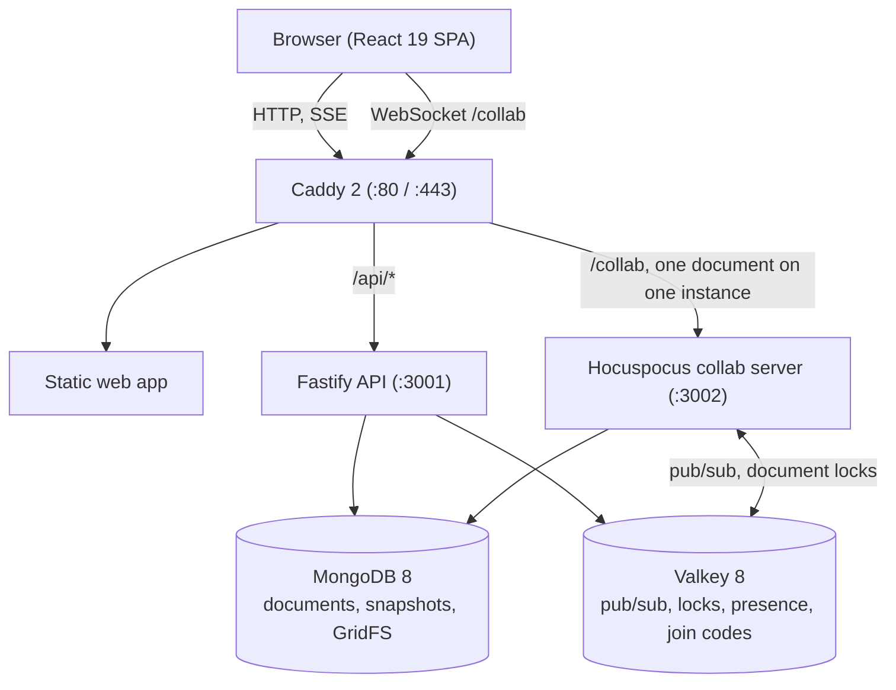

[English](README.md) | [한국어](README.ko.md)

# codesh

> Self-hosted, real-time code sharing for one network.

codesh lets everyone on the same network share code and edit it together in the browser. There are no accounts to create, no cloud services, no analytics and no CDN: every font, icon and script is served from your own server, so it runs fully offline or in an air-gapped environment. Edits merge without conflicts (Yjs CRDT), every language gets syntax highlighting, and a lab mode gives a teacher a live grid of every student's editor.


## Screenshots

| | |
|---|---|
|  |  |
|  |  |
|  |  |
|  |  |

## What you can do

### Share and join
- **Instant shares**: one click creates a share with an 8-character address (`/<id>`) and a 6-digit join code (`/<code>`). No sign-up.
- **Join your way**: type the 6-digit code, open the link, or scan the QR code (drawn in the browser, with a full-screen mode for a projector).
- **Nearby shares**: shares that are open on your subnet, or in a room the administrator defined, are listed on the start page.
- **Send and broadcast**: send a share to someone who is online with a note of up to 200 characters, or show an invitation to the whole room.

### Edit together
- **Conflict-free editing**: concurrent typing is merged by Yjs and Hocuspocus; offline edits merge when the connection comes back.
- **Cursors and following**: everyone's cursor and selection carry a colour and a name; click a participant to follow their view.
- **Several files and folders**: up to 100 files per share, folders by path (`src/index.ts`), language detected from the file name.
- **200+ languages**: syntax highlighting with four editor themes (Slate, Graphite, Paper, Sand) whose token colours are checked for WCAG 2.2 AA contrast. Default, Vim, Emacs and Sublime keymaps.
- **Anchored comments**: attach a discussion to a line or range; it keeps its place while the text moves.
- **Uploads and downloads**: drop files, folders or `.zip` archives into the window; download one file or the whole share as a `.zip`.
- **Organise and start fast**: personal folders and up to 10 tags per share in My shares, 16 built-in templates and templates added by the administrator.

### History
- **Automatic snapshots**: about every 30 seconds of activity, at most 100 per share, kept 7 days by default.
- **Playback and diff**: play a share back at 1×, 2× or 4×, and compare any version with the previous one or the current text.
- **Safe restore**: restoring a version is a normal edit, so the history stays intact.
- **Deleted text stays private**: participants only ever receive the current state of the document. What was deleted stays on the server and only the owner can see it in the history.

### Classroom and lab
- **Lab sessions**: `/lab/new` creates a lab with a 6-digit code; every student gets a personal copy.
- **Live grid**: the teacher sees every student's online state and code at once, can zoom into one tile or step into that editor.
- **Hand out examples**: send one of your shares to every student's workspace in one click.
- **Edit lock**: freeze every student editor while you explain.

### Control and privacy
- **View-only by default, if you want it**: share a view-only link and give the separate edit link only to people you trust. The edit link ends in `#key=…`; browsers never send the fragment to a server, and codesh removes it from the address bar at once. Old `?key=` links still work and are cleaned the same way.
- **PIN lock**: a 4–32 character PIN, stored as a scrypt hash; 5 wrong tries lock the address out for 10 minutes.
- **Waiting room**: you approve every newcomer before they get in.
- **Kick and ban**: remove someone, or ban them by client and network address.
- **Offline copy you control**: the editor keeps an offline copy in the browser so edits survive a lost connection. On a shared computer, turn it off in Settings (it deletes what is stored for that share) or use **Forget on this device**, which removes this share's copy and saved edit key from every open tab. Removal, a ban, a refused authorisation, a deleted share, signing out and switching accounts delete the copies automatically.
- **Nothing leaves the network at runtime**: no external fonts, CDNs, analytics or widgets. The one optional request is the update check described below, and you can turn it off.

### Terminal CLI
The CLI lives in `packages/cli` and is built from this repository (`pnpm --filter @codesh/cli build`).
- `codesh push <file…>`: share files, folders or standard input; prints the URL, the join code and a QR code.
- `codesh open <code|id>`: open a share in the browser.
- `codesh pull <code|id>`: download a share as files or a `.zip`, with `--pin` for locked shares.

### Admin
- **Console** (`/admin`, admin token): settings such as share lifetime, history retention, upload size and guest access; rooms for nearby shares; custom templates.
- **Optional sign-in**: OIDC or LDAP, while guests can stay allowed.
- **Audit log, people, status and updates** tabs.

## How to use

1. **Start**: open the home page and press **New share**, or **Start from a template**.
2. **Invite**: press **Share** (`⌃⌘S` on a Mac, `Ctrl+Alt+S` elsewhere) to copy the link, read out the 6-digit code or show the QR code.
3. **Join**: type the code on the home page, or open `/<code>` or `/<id>`.
4. **Edit together** with live cursors, highlighting and comments (`⌃⌘M` / `Ctrl+Alt+M`).
5. **Manage files**: add files and folders from the file panel, or drop files and `.zip` archives into the window.
6. **Review history** as the owner with **History** (`⌃⌘H` / `Ctrl+Alt+H`).
7. **Export**: download a file, or the whole share as a `.zip`.

Press `?` outside a text field for the shortcuts of your operating system. The full list is in the [User guide](docs/USER-GUIDE.md) (written in Korean, with an English quick reference at the end).

| Action | Mac | Windows / Linux |
|---|---|---|
| Command palette | `⌘ K` or `F1` | `Ctrl + K` or `F1` |
| Share dialog | `⌃ ⌘ S` | `Ctrl + Alt + S` |
| Settings | `⌘ ,` | `Ctrl + ,` |
| Comments | `⌃ ⌘ M` | `Ctrl + Alt + M` |
| History (owner) | `⌃ ⌘ H` | `Ctrl + Alt + H` |
| Copy all code | `⌃ ⌘ C` | `Ctrl + Alt + C` |
| Format code | `⇧ ⌥ F` | `Shift + Alt + F` |
| Find / replace | `⌘ F` / `⌘ ⌥ F` | `Ctrl + F` / `Ctrl + H` |
| Add cursor above / below | `⌘ ⌥ ↑` / `⌘ ⌥ ↓` | `Ctrl + Alt + ↑` / `Ctrl + Alt + ↓` |
| Select next occurrence | `⌘ D` | `Ctrl + D` |

## Install

codesh runs on any Linux host with Docker Engine and the Docker Compose plugin (`docker compose`). Only Caddy publishes ports: HTTP (80) and HTTPS (443).

| Scale | Minimum | Recommended | Notes |
|---|---|---|---|
| One share with 50 people | 2 vCPU, 4 GB RAM, 20 GB SSD | 4 vCPU, 8 GB RAM | with 4 GB RAM set `MONGO_CACHE_GB=1` |
| About 200 people at once (classes, labs, small shares) | 4 vCPU, 8 GB RAM, 40 GB SSD | 8 vCPU, 16 GB RAM | one collab instance is enough; use `COLLAB_REPLICAS=2` from about 400 people |

### With internet: Docker Compose

```sh
git clone https://github.com/kim0040/codesh.git && cd codesh/deploy
cp .env.example .env && ./generate-secrets.sh     # once; .env stays on the host
docker compose pull && docker compose up -d       # public images from ghcr.io/kim0040
curl http://localhost/healthz
```

### Without internet: the offline bundle

Download `codesh-<version>-linux-amd64.tar.gz` (or `-linux-arm64`) and its `.sha256` file from [GitHub Releases](https://github.com/kim0040/codesh/releases) on a connected machine, carry both to the server, and run:

```sh
sha256sum -c codesh-<version>-linux-amd64.tar.gz.sha256
tar xzf codesh-<version>-linux-amd64.tar.gz && cd codesh-<version>-linux-amd64
PUBLIC_URL=http://codesh.local ./install.sh       # loads the images, writes .env with new secrets, starts, waits for /healthz
```

`install.sh` checks every file of the bundle against the `SHA256SUMS` inside it before loading anything. A checksum is not a signature: compare the `.sha256` value with one you received over a trusted channel. Release files also carry build attestations (`gh attestation verify`, see [RELEASING.md](RELEASING.md)). The bundle contains the unmodified official MongoDB, Valkey, Caddy and Node images next to the codesh images, plus `backup.sh`, `restore.sh`, `upgrade.sh` and `update.sh`.

To upgrade an offline installation, copy the new bundle and its `.sha256` file next to each other and run `./upgrade.sh ../codesh-<newer>-linux-amd64.tar.gz` (it checks the checksum, backs up the database, loads the images and keeps your `.env`).

### HTTPS

`SITE_ADDRESS=:80` serves plain HTTP. If you set a host name (such as `codesh.local`), Caddy needs a `tls` line in `deploy/tls/*.caddy`: `tls internal` for Caddy's own CA, or your certificate and key. Without it Caddy tries a public ACME CA, which fails on a network without internet. Plain HTTP exposes document content and credentials to anyone who can watch the traffic, so use HTTPS wherever the network is shared. Details and client CA trust steps: [deploy/tls/README.md](deploy/tls/README.md).

Backups, scaling, monitoring and every `.env` setting are in the [Operations guide](docs/OPERATIONS.md) (Korean) and [deploy/README.md](deploy/README.md) (English).

## Updates

- **Release check**: with `UPDATE_CHECK=on` (the default) the API asks `GET https://api.github.com/repos/<UPDATE_REPO>/releases/latest` a few minutes after it starts and then about every 12 hours. This is the only outside request codesh ever makes. It sends no cookies, identifiers or statistics, never blocks a request, and fails quietly after 5 seconds when there is no internet. `UPDATE_CHECK=off` in `.env` turns it off completely. A newer release shows up in the admin console.
- **Manual update with rollback** (in an installed bundle):
  ```sh
  ./update.sh --check              # installed vs. newest release; changes nothing
  ./update.sh                      # checksums, database backup, pull, /healthz and /readyz; rolls back on failure
  ./update.sh --bundle <path>      # apply an offline bundle
  ```
- **Automatic updates** (off by default):
  ```sh
  sudo ./update.sh --enable-auto --at 04:00 --policy patch   # or --policy minor
  sudo ./update.sh --disable-auto
  ```
  A systemd timer (or cron) applies releases of the chosen kind. Major versions are never installed automatically.
- Everything involved is free: a public repository, public GHCR packages, GitHub Actions with build attestations and unauthenticated GitHub API calls. Operator details: [Operations guide §15](docs/OPERATIONS.md), release process: [RELEASING.md](RELEASING.md).

## How it works



- **Yjs and Hocuspocus**: edits travel over a WebSocket and merge deterministically; no polling.
- **Scale-out**: several `collab` replicas coordinate through Valkey (document locks `doclock:<id>`, permission and command channels); Caddy sends all connections for one document to the same replica.
- **Storage**: the live Y.Doc is in memory and edits never wait for the database; a flusher writes batched updates to MongoDB every 100 ms and compacts them into a snapshot every 200 updates. Uploads live in MongoDB GridFS.
- **Deleted text**: the server runs Yjs with `gc: true` and sends joining clients only the current state, so deleted text is never transmitted to participants.
- **Offline**: the browser mirrors each document with `y-indexeddb` and merges it when the connection returns (switchable per device).
- **Self-hosted**: Pretendard and JetBrains Mono fonts, icons and every script are inside the images.

**Measured on one 4 vCPU / 8 GB VM** (loopback network, load generator on the same machine; details in [Operations guide §11](docs/OPERATIONS.md)):
- 50 people in one share: edit latency p95 ≈ 10.6 ms, cursor p95 ≈ 33 ms (cursors are batched in 30 ms windows), no lost or duplicated updates, every replica converged.
- About 200 people across classes, labs and small shares: edit p95 ≈ 31 ms, no dropped updates.
- Reconnect storm: when all 50 connections of a share drop at once they are back in sync within 1 s (p95 0.6 s; 0.8 s on a saturated VM); after a collab restart within about 4 s. No update was lost in any run.

## Development

Needs Node.js 22 or newer, pnpm 9.15 (`corepack enable`) and Docker with Compose.

```sh
pnpm install
pnpm services:up      # MongoDB 8 and Valkey 8 for development
pnpm dev              # web on :5173, API on :3001, collab on :3002
pnpm check            # Biome, TypeScript typecheck, Vitest, license check
pnpm test:e2e         # Playwright; first: pnpm --filter @codesh/web exec playwright install chromium
pnpm services:down
```

The repository is a pnpm and Turborepo monorepo (`apps/web`, `apps/api`, `apps/collab`, `packages/*`); [docs/ARCHITECTURE.md](docs/ARCHITECTURE.md) describes it. The screenshots above are made by `apps/web/e2e/readme-shots.spec.ts`. Contributions are welcome: see [CONTRIBUTING.md](CONTRIBUTING.md).

## Security

- PINs are hashed with scrypt and compared in constant time; repeated failures lock the address out for 10 minutes.
- Waiting room, kick and ban (by client and network address), and view-only links with the edit key kept in the URL fragment, which is never sent to the server, and removed from the address bar.
- Browser defences: Content Security Policy, `nosniff`, frame denial, and a required `X-Codesh: 1` header (or same-origin `Origin`) on every API request that changes something, against cross-site form posts.
- The API and collab connect to MongoDB as `codesh_app`, with `readWrite` on the `codesh` database only; the root credentials are used by the initialisation and backup scripts.
- Rate limits per address on API calls, join-code attempts, share creation and sign-in; an IPv6 /64 is counted together.

Please report vulnerabilities privately; see [SECURITY.md](SECURITY.md).

## Documentation

- [User guide](docs/USER-GUIDE.md): sharing, editing, access control, lab mode, settings, shortcuts, troubleshooting (Korean, English quick reference at the end)
- [Operations guide](docs/OPERATIONS.md): requirements, offline install, configuration, TLS, scaling, backup, monitoring, capacity, updates (Korean)
- [Architecture](docs/ARCHITECTURE.md): topology, data model, collaboration protocol, security design
- [Deployment](deploy/README.md): images, Compose, Caddy, bundles and updates
- [Releasing](RELEASING.md): versions, the release workflow, verifying a release
- [Changelog](CHANGELOG.md)

## License

Distributed under the [MIT License](LICENSE). See [Third-party notices](THIRD_PARTY_NOTICES.md) for the libraries, fonts and base images used. MongoDB Community Server (SSPL) is used unmodified as the internal database; it is not part of this repository, and the offline bundle contains the unmodified official image.

## Contributors

김현민 (mini0227kim@gmail.com)
