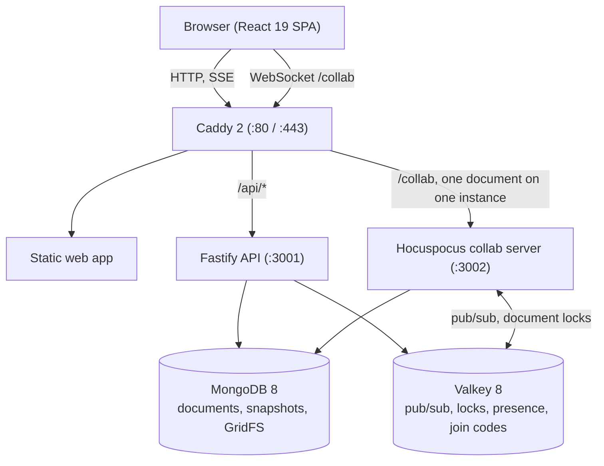

[English](README.md) | [한국어](README.ko.md)

# gachipad

> Self-hosted, real-time code sharing for your own network.

gachipad lets everyone on the same network share and edit code together directly in the browser. There are no accounts to create, no external cloud services, no tracking analytics, and no CDNs: every font, icon, and script is served from your own server, so it runs completely offline or in an air-gapped environment. Edits merge without conflicts using Yjs CRDTs, syntax highlighting supports over 200 languages, and a lab mode provides teachers with a real-time grid of every student's editor.


## Screenshots

| | |
|---|---|
|  |  |
|  |  |
|  |  |
|  |  |

## Features

### Share and join
- **Instant shares**: Create a share in one click with an 8-character address (`/<id>`) and a 6-digit join code (`/<code>`). No sign-up required by default.
- **Join your way**: Enter the 6-digit code, open the direct link, or scan the in-browser QR code (includes a full-screen mode for projectors).
- **Nearby shares**: Discover shares open on your subnet, or in a room defined by the administrator, right on the start page.
- **Send and broadcast**: Send a share invitation with a note of up to 200 characters to an online participant, or display an invitation to the entire room.

### Collaborative editing
- **Conflict-free sync**: Concurrent typing merges automatically with Yjs and Hocuspocus; offline edits merge cleanly when the connection returns.
- **Presence and following**: Every cursor and selection shows a distinct colour and name; click any participant to follow their view in real time. Remote edits do not disrupt local cursor blinking, and remote name tags stay stable.
- **Smooth typing**: The caret glides with a 100 ms decelerating transition and smooth opacity blinking; it stays solid when reduced motion is preferred.
- **Code completion & language suggestions**: Optional keyword and word suggestions after a short pause in typing, accepted with Tab; automatic language detection offers one-click language assignment while typing plain text.
- **Multi-file workspaces**: Organize up to 100 files per share in folder paths (`src/index.ts`), with automatic language detection from file names.
- **200+ languages and accessible themes**: Syntax highlighting for 200+ languages across four editor themes (Slate, Graphite, Paper, Sand) with token colours verified for WCAG 2.2 AA contrast. Keymaps include Default, Vim, Emacs, and Sublime.
- **Anchored comments**: Attach discussions to a line or range; comments hold their place as surrounding code moves.
- **File import and export**: Drag and drop files, folders, or `.zip` archives directly into the window; download a single file or export the whole share as a `.zip`.
- **Organization and quick start**: Group projects with custom folders and up to 10 tags in My shares; start quickly with 16 built-in templates or custom templates added by the administrator.

### History
- **Automatic snapshots**: Captured roughly every 30 seconds of activity, saving up to 100 snapshots per share (retained for 7 days by default).
- **Playback and diff**: Play back editing history at 1×, 2×, or 4× speed, and compare any revision against the previous version or the current text.
- **Safe restore**: Restoring an earlier version applies as a new edit, preserving the entire revision history.
- **Deleted text stays private**: Participants only ever receive the current document state. Deleted text stays on the server and is visible only to the owner in the history view.

### Classroom and lab
- **Lab sessions**: Create a session at `/lab/new` with a 6-digit code; each student automatically receives an independent personal copy.
- **Live grid**: Teachers can view every student's online status and editor at once, zoom in on a single tile, or jump into that workspace to help.
- **Distribute code**: Push an example share to every student workspace in one click.
- **Edit lock**: Freeze all student editors during explanations.

### Control and privacy
- **View-only by default**: Share a view-only link freely and provide the separate edit link only to trusted collaborators. The edit link carries `#key=…` in the URL fragment, which browsers never send to the server; gachipad removes it from the address bar immediately. Legacy `?key=` links continue to work and are cleaned the same way.
- **Participant permissions**: Owners control whether editors can rename the share, add or delete files, or change file languages, with server-side verification. If an edit is refused, unsent changes are kept in memory for recovery.
- **PIN lock**: Protect shares with a 4–32 character PIN stored as a scrypt hash; 5 wrong attempts lock out the client address for 10 minutes.
- **Waiting room**: Review and approve each newcomer before granting entry.
- **Kick and ban**: Remove a participant immediately, or ban them by client and network address.
- **Offline copy you control**: The browser keeps no offline copy until you answer a one-time question in the editor ("Keep on this device" / "Not on this device"; changeable in Settings). **Forget on this device** closes the share in every tab of the browser, deletes its copy and saved edit key, and keeps no copy for that share until asked again; if there are edits the server has not confirmed, it asks first. Removal, a ban, a refused authorization, a deleted share, signing out, and switching accounts delete copies automatically. Lab previews never keep copies.
- **Local diagnostics export**: Bounded error, connection, and performance logging in Settings (up to 500 event groups, 256 KB, 14 days) and the admin console; nothing is sent automatically, and document contents and secrets are scrubbed.
- **Nothing leaves the network at runtime**: No external fonts, CDNs, analytics, or third-party widgets. The single optional outbound request is the release check described below, which can be disabled.

### Guides and tutorial
- **First-run tour**: Interactive spotlight walk-through highlighting key controls on the first editor visit, replayable anytime from Settings.
- **In-app guide**: Comprehensive documentation under `/guide` for workflow, features, network topology, security, and FAQs.

### Terminal CLI
The CLI lives in `packages/cli` and is built directly from this repository (`pnpm --filter @gachipad/cli build`). The `codesh` command is retained as a deprecated alias.
- `gachipad push <file…>`: Share files, folders, or standard input; outputs the URL, join code, and QR code.
- `gachipad open <code|id>`: Open a share in the browser.
- `gachipad pull <code|id>`: Download a share as individual files or a `.zip`, with `--pin` for locked shares.

### Admin
- **Console** (`/admin`, admin token): Manage share lifetimes, history retention, upload size limits, guest access, rooms for nearby shares, and custom templates. Hardened with optional `ADMIN_ALLOW_CIDR`, a global guess rate limit, and cleartext HTTP warnings.
- **Optional sign-in**: Connect OIDC or LDAP authentication, while keeping guest access enabled if desired.
- **Administrative panels**: Dedicated views for system overview (metrics, health, 24 h activity), shares (search, lock/unlock, delete), diagnostics and server bundle export, security audit, people, status, and updates.

## How to use

1. **Start**: Open the home page and click **New share**, or select **Start from a template**.
2. **Invite**: Click **Share** (`⌃⌘S` on a Mac, `Ctrl+Alt+S` elsewhere) to copy the link, read out the 6-digit code or show the QR code.
3. **Join**: Type the code on the home page, or open `/<code>` or `/<id>`.
4. **Edit together**: Collaborate in real time with live cursors, highlighting and comments (`⌃⌘M` / `Ctrl+Alt+M`).
5. **Manage files**: Add files and folders from the file panel, or drop files and `.zip` archives into the window.
6. **Review history**: As the owner, open **History** (`⌃⌘H` / `Ctrl+Alt+H`) to inspect revisions and diffs.
7. **Export**: Download a file, or the whole share as a `.zip`.

Press `?` outside a text field for the shortcuts of your operating system. The full list is in the [User guide](docs/USER-GUIDE.md) (written in Korean, with an English quick reference at the end).

| Action | Mac | Windows / Linux |
|---|---|---|
| Command palette | `⌘ K` or `F1` | `Ctrl + K` or `F1` |
| Share dialog | `⌃ ⌘ S` | `Ctrl + Alt + S` |
| Settings | `⌘ ,` | `Ctrl + ,` |
| Comments | `⌃ ⌘ M` | `Ctrl + Alt + M` |
| History (owner) | `⌃ ⌘ H` | `Ctrl + Alt + H` |
| Copy all code | `⌃ ⌘ C` | `Ctrl + Alt + C` |
| Format code | `⇧ ⌥ F` | `Shift + Alt + F` |
| Find / replace | `⌘ F` / `⌘ ⌥ F` | `Ctrl + F` / `Ctrl + H` |
| Add cursor above / below | `⌘ ⌥ ↑` / `⌘ ⌥ ↓` | `Ctrl + Alt + ↑` / `Ctrl + Alt + ↓` |
| Select next occurrence | `⌘ D` | `Ctrl + D` |

## Install

Upgrading an existing 1.0.x installation? See [Renaming codesh to gachipad (upgrading from 1.0.x)](docs/OPERATIONS.md#16-codesh에서-gachipad로-이름-변경-10x에서-업그레이드) in the Operations guide.

gachipad runs on any Linux host with Docker Engine and the Docker Compose plugin (`docker compose`). Only Caddy publishes ports: HTTP (80) and HTTPS (443).

| Scale | Minimum | Recommended | Notes |
|---|---|---|---|
| One share with 50 people | 2 vCPU, 4 GB RAM, 20 GB SSD | 4 vCPU, 8 GB RAM | with 4 GB RAM set `MONGO_CACHE_GB=1` |
| About 200 people at once (classes, labs, small shares) | 4 vCPU, 8 GB RAM, 40 GB SSD | 8 vCPU, 16 GB RAM | one collab instance is enough; use `COLLAB_REPLICAS=2` from about 400 people |

### With internet: Docker Compose

```sh
git clone https://github.com/kim0040/gachipad.git && cd gachipad/deploy
cp .env.example .env && ./generate-secrets.sh     # once; .env stays on the host
docker compose pull && docker compose up -d       # public images from ghcr.io/kim0040
curl http://localhost/healthz
```

### Without internet: the offline bundle

Download `gachipad-<version>-linux-amd64.tar.gz` (or `-linux-arm64`) and its `.sha256` file from [GitHub Releases](https://github.com/kim0040/gachipad/releases) on a connected machine, carry both to the server, and run:

```sh
sha256sum -c gachipad-<version>-linux-amd64.tar.gz.sha256
tar xzf gachipad-<version>-linux-amd64.tar.gz && cd gachipad-<version>-linux-amd64
PUBLIC_URL=http://gachipad.local ./install.sh       # loads the images, writes .env with new secrets, starts, waits for /healthz
```

`install.sh` checks every file of the bundle against the `SHA256SUMS` inside it before loading anything. A checksum is not a signature: compare the `.sha256` value with one you received over a trusted channel. Release files also carry build attestations (`gh attestation verify`, see [RELEASING.md](RELEASING.md)). The bundle contains the unmodified official MongoDB, Valkey, Caddy and Node images next to the gachipad images, plus `backup.sh`, `restore.sh`, `upgrade.sh` and `update.sh`.

To upgrade an offline installation, copy the new bundle and its `.sha256` file next to each other and run `./upgrade.sh ../gachipad-<newer>-linux-amd64.tar.gz` (it checks the checksum, backs up the database, loads the images and keeps your `.env`).

### HTTPS

`SITE_ADDRESS=:80` serves plain HTTP. If you set a host name (such as `gachipad.local`), Caddy needs a `tls` line in `deploy/tls/*.caddy`: `tls internal` for Caddy's own CA, or your certificate and key. Without it Caddy tries a public ACME CA, which fails on a network without internet. Plain HTTP exposes document content and credentials to anyone who can watch the traffic, so use HTTPS wherever the network is shared. Details and client CA trust steps: [deploy/tls/README.md](deploy/tls/README.md).

Backups, scaling, monitoring and every `.env` setting are in the [Operations guide](docs/OPERATIONS.md) (Korean) and [deploy/README.md](deploy/README.md) (English).

## Updates

- **Release check**: with `UPDATE_CHECK=on` (the default) the API asks `GET https://api.github.com/repos/<UPDATE_REPO>/releases/latest` a few minutes after it starts and then about every 12 hours. This is the only outside request gachipad ever makes. It sends no cookies, identifiers or statistics, never blocks a request, and fails quietly after 5 seconds when there is no internet. `UPDATE_CHECK=off` in `.env` turns it off completely. A newer release shows up in the admin console.
- **Manual update with rollback** (in an installed bundle):
  ```sh
  ./update.sh --check              # installed vs. newest release; changes nothing
  ./update.sh                      # checksums, database backup, pull, /healthz and /readyz; rolls back on failure
  ./update.sh --bundle <path>      # apply an offline bundle
  ```
- **Automatic updates** (off by default):
  ```sh
  sudo ./update.sh --enable-auto --at 04:00 --policy patch   # or --policy minor
  sudo ./update.sh --disable-auto
  ```
  A systemd timer (or cron) applies releases of the chosen kind. Major versions are never installed automatically.
- Everything involved is free: a public repository, public GHCR packages, GitHub Actions with build attestations and unauthenticated GitHub API calls. Operator details: [Operations guide §15](docs/OPERATIONS.md), release process: [RELEASING.md](RELEASING.md).

## How it works



- **Yjs and Hocuspocus**: edits travel over a WebSocket and merge deterministically; no polling.
- **Scale-out**: several `collab` replicas coordinate through Valkey (document locks `doclock:<id>`, permission and command channels); Caddy sends all connections for one document to the same replica.
- **Storage**: the live Y.Doc is in memory and edits never wait for the database; a flusher writes batched updates to MongoDB every 100 ms and compacts them into a snapshot every 200 updates. Uploads live in MongoDB GridFS.
- **Deleted text**: the server runs Yjs with `gc: true` and sends joining clients only the current state, so deleted text is never transmitted to participants.
- **Offline**: the browser mirrors each document with `y-indexeddb` and merges it when the connection returns (switchable per device).
- **Self-hosted**: Pretendard and JetBrains Mono fonts, icons and every script are inside the images.

**Measured on one 4 vCPU / 8 GB VM** (loopback network, load generator on the same machine; details in [Operations guide §11](docs/OPERATIONS.md)):
- 50 people in one share: edit latency p95 ≈ 10.6 ms, cursor p95 ≈ 33 ms (cursors are batched in 30 ms windows), no lost or duplicated updates, every replica converged.
- About 200 people across classes, labs and small shares: edit p95 ≈ 31 ms, no dropped updates.
- Reconnect storm: when all 50 connections of a share drop at once they are back in sync within 1 s (p95 0.6 s; 0.8 s on a saturated VM); after a collab restart within about 4 s. No update was lost in any run.

## Development

Needs Node.js 22 or newer, pnpm 9.15 (`corepack enable`) and Docker with Compose.

```sh
pnpm install
pnpm services:up      # MongoDB 8 and Valkey 8 for development
pnpm dev              # web on :5173, API on :3001, collab on :3002
pnpm check            # Biome, TypeScript typecheck, Vitest, license check
pnpm test:e2e         # Playwright; first: pnpm --filter @gachipad/web exec playwright install chromium
pnpm services:down
```

The repository is a pnpm and Turborepo monorepo (`apps/web`, `apps/api`, `apps/collab`, `packages/*`); [docs/ARCHITECTURE.md](docs/ARCHITECTURE.md) describes it. The screenshots above are made by `apps/web/e2e/readme-shots.spec.ts`. Contributions are welcome: see [CONTRIBUTING.md](CONTRIBUTING.md).

## Security

- PINs are hashed with scrypt and compared in constant time; repeated failures lock the address out for 10 minutes.
- Waiting room, kick and ban (by client and network address), and view-only links with the edit key kept in the URL fragment, which is never sent to the server, and removed from the address bar.
- Browser defences: Content Security Policy, `nosniff`, frame denial, and a required `X-Gachipad: 1` header (or same-origin `Origin`) on every API request that changes something, against cross-site form posts.
- The API and collab connect to MongoDB as `gachipad_app`, with `readWrite` on the `gachipad` database only; the root credentials are used by the initialisation and backup scripts.
- Rate limits per address on API calls, join-code attempts, share creation and sign-in; an IPv6 /64 is counted together.

Please report vulnerabilities privately; see [SECURITY.md](SECURITY.md).

## Documentation

- [User guide](docs/USER-GUIDE.md): sharing, editing, access control, lab mode, settings, shortcuts, troubleshooting (Korean, English quick reference at the end)
- [Operations guide](docs/OPERATIONS.md): requirements, offline install, configuration, TLS, scaling, backup, monitoring, capacity, updates (Korean)
- [Architecture](docs/ARCHITECTURE.md): topology, data model, collaboration protocol, security design
- [Deployment](deploy/README.md): images, Compose, Caddy, bundles and updates
- [Releasing](RELEASING.md): versions, the release workflow, verifying a release
- [Changelog](CHANGELOG.md)

## License

Distributed under the [MIT License](LICENSE). See [Third-party notices](THIRD_PARTY_NOTICES.md) for the libraries, fonts and base images used. MongoDB Community Server (SSPL) is used unmodified as the internal database; it is not part of this repository, and the offline bundle contains the unmodified official image.

## Contributors

김현민 (mini0227kim@gmail.com)
